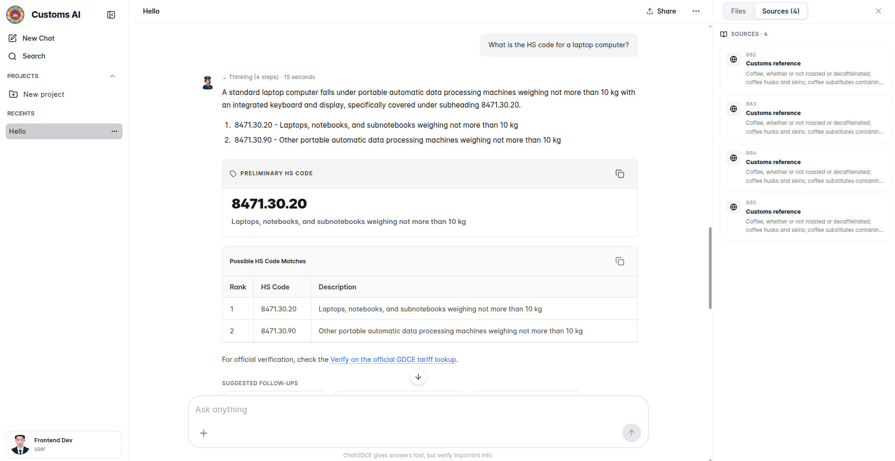
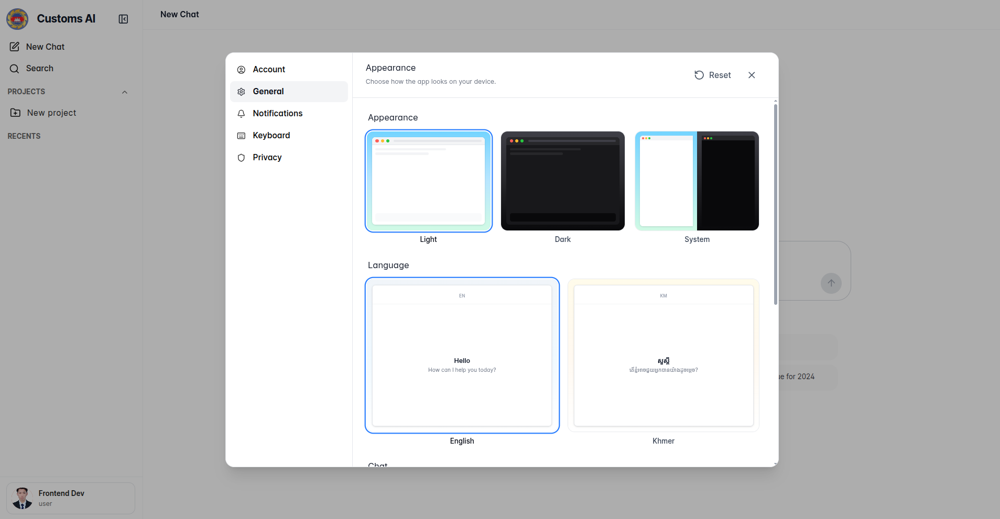
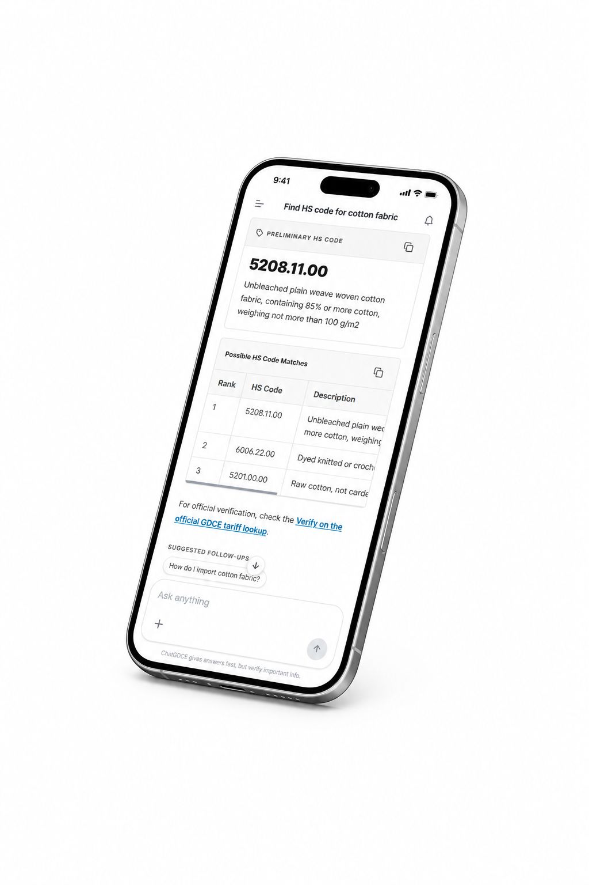
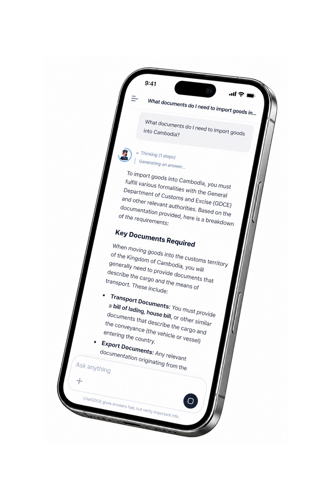

# GDCE Customs AI Platform

GDCE Customs AI Platform is a full-stack, multi-service assistant for customs and trade workflows. It pairs a responsive conversational interface with specialized services for tariff-code discovery, duty calculations, trade-data questions, and retrieval from a Cambodian GDCE document corpus.

Built as a portfolio-scale system rather than a single chat UI, the repository includes the web client, an authenticated API gateway, domain services, data-access tooling, and containerized local-development workflows.

## Product at a Glance

### HS-code workspace



**HS-code workflow.** A ranked customs-code result, source panel, follow-up prompts, and persistent chat navigation.

### Portfolio settings



**Personalized settings.** Configure appearance, language, chat, notification, keyboard, and privacy preferences from one desktop settings panel.

| Mobile HS-code workflow | Mobile document guidance |
| --- | --- |
|  |  |
| **Responsive mobile workflow.** The HS-code result and follow-up chat controls adapt to a mobile device layout. | **Mobile document guidance.** A conversational response explains documents needed to import goods into Cambodia. |

## Key Features

### Customer-Facing Experience

- Conversational customs assistant with streamed responses and persistent chat threads.
- Projects for organizing chats, plus search, rename, archive, delete, and share/revoke-share flows.
- Authentication screens, profile and preference settings, localization support, keyboard shortcuts, and light/dark UI themes.
- Rich response rendering for Markdown, syntax-highlighted code, tables, charts, citations/references, images, workflow content, and Mermaid diagrams.
- Image upload and preview support, with configured file-type and size limits.
- Domain-aware requests for HS-code classification, customs duty calculation, trade statistics, and general GDCE policy/FAQ retrieval.

### Administration and Operations

- Authenticated API-key lifecycle endpoints and audit/request logging at the API layer.
- Health, readiness, and dependency-status endpoints for service monitoring.
- Calculator administration endpoints for formulas, rounding rules, policies, exemptions, cache refresh, rule previews, and audit-log access; these are protected when `ADMIN_API_KEY` is configured.
- Data Access Layer (DAL) scripts and tiered API-key support for local metadata and trade-data setup.

### Backend and Data Capabilities

- FastAPI API gateway with JWT access/refresh tokens, bcrypt password hashing, hashed stored API keys and refresh tokens, Redis-backed rate limiting, CORS configuration, and ownership checks for projects, chats, and files.
- Server-Sent Events (SSE) proxying for incremental chat output, plus asynchronous job status/result proxy endpoints for generated artifacts.
- Intent routing through an orchestrator to separate retrieval, calculator, trade, and general-information services.
- PostgreSQL-backed gateway metadata; Redis caching/rate counters; Qdrant-backed retrieval services; MinIO/S3-compatible file storage; RabbitMQ-backed image-job infrastructure.

> **Payments:** This repository does not contain a payment or checkout integration, so none is claimed here.

## Technology Stack

| Area | Technologies present in the repository |
| --- | --- |
| Web client | Nuxt 4, Vue 3, TypeScript, Pinia, Vuetify, Tailwind CSS, Vue I18n |
| Rich content UI | Markdown-it, DOMPurify, Shiki, Mermaid, Apache ECharts, PDF.js, Lucide |
| Gateway API | Python, FastAPI, SQLAlchemy async, Alembic, Pydantic, HTTPX |
| Domain services | Python/FastAPI orchestrator, retrieval, calculator, trade, and general-information services |
| Data and infrastructure | PostgreSQL, Redis, Qdrant, MinIO (S3-compatible), RabbitMQ, Docker Compose |
| AI/retrieval integrations | Gemini support in retrieval/general services; optional Ollama/vLLM paths documented in service code |
| Quality tooling | Pytest/pytest-asyncio, ESLint, Prettier, Vue TypeScript checking |

## Architecture

```text
Nuxt web client (port 3000)
        |
        v
FastAPI API layer (port 8000) -- PostgreSQL / Redis / MinIO / RabbitMQ
        |
        v
Orchestrator (port 8001)
   |       |          |          |
   v       v          v          v
Calculator  Retrieval  Trade    General
  :8002      :8003    :8004     :8005
```

The API layer owns identity, access control, gateway metadata, rate limits, and logs. The orchestrator routes requests to the specialized services; those services own their respective domain logic and response generation.

## Repository Structure

```text
.
├── frontend/                  # Nuxt/Vue client and UI tests
├── backend/api-layer/         # FastAPI gateway, Alembic migrations, API tests
├── services_version2/
│   ├── orchestrator/          # Intent detection, query rewriting, service routing
│   ├── retrieval/             # HS-code classification service
│   ├── calculator/            # Customs duty calculation and rule management
│   ├── trade/                 # Trade statistics query service
│   └── general/               # GDCE policy, FAQ, and definition retrieval
├── data/dal/                  # Trade-data/metadata access layer and seed scripts
├── image-worker/              # Background image-job worker
├── gdce_postgre_db/           # Local database dump/restore assets
├── bruno/                     # API request collections
└── scripts/                   # Docker and service helper scripts
```

## Run Locally

### Prerequisites

- Node.js 22+ and Corepack/pnpm (the frontend Dockerfile uses Node 22; the frontend declares pnpm 10).
- Python 3.12+ for the API layer; individual services document their own Python requirements.
- Docker Engine with Docker Compose for the containerized stack.
- PostgreSQL 16+ and Redis 7+ when running the API layer outside Docker.
- Service credentials and data where required—for example, a Gemini API key and populated Qdrant collection for retrieval/general services, and DAL configuration for trade queries.

### Frontend

```bash
cd frontend
cp .env.example .env
pnpm install
pnpm dev
```

Open `http://localhost:3000`. By default the client expects the API layer at `http://localhost:8000`; update `NUXT_PUBLIC_GDCE_API_BASE_URL` in `frontend/.env` if needed.

### API Layer (Without Docker)

```bash
cd backend/api-layer
python -m venv .venv
# Linux/macOS
source .venv/bin/activate
# Windows PowerShell: .venv\Scripts\Activate.ps1
pip install -r requirements.txt
cp .env.example .env
# Set non-placeholder secrets and connection values in .env.
alembic upgrade head
uvicorn app.main:app --reload --port 8000
```

The interactive API contract is available at `http://localhost:8000/docs` when `ENABLE_DOCS=true`.

### Docker Services

The service compose files share an external Docker network. Create it once, configure the relevant `.env` files, then start the services in dependency order:

```bash
docker network create gdce-network

cd services_version2/retrieval && docker compose up -d --build
cd ../general && docker compose up -d --build
cd ../calculator && docker compose up -d --build
cd ../trade && docker compose up -d --build
cd ../orchestrator && docker compose up -d --build
cd ../../backend/api-layer && cp .env.example .env && docker compose up -d --build
cd ../../frontend && cp .env.example .env && docker compose up -d --build
```

On Windows PowerShell, `backend/api-layer/scripts/start-development.ps1` starts the five backend/domain compose stacks (but not the frontend). Run it from the repository root; use `-SkipBuild` to reuse images.

```powershell
./backend/api-layer/scripts/start-development.ps1
cd frontend
docker compose up -d --build
```

> The calculator needs its duty-rate data populated for authoritative calculations. The trade service needs valid `DAL_BASE_URL` and `DAL_API_KEY`; retrieval and general services need their required corpus/vector data. The development orchestrator keeps chat history in memory, so restarting it clears that history.

### Local-Development Credentials

No application user or administrator credentials are documented here because this repository does not include a corresponding application-user seeder. Register a local user through the UI or `POST /api/v1/auth/register` after starting the API layer.

The DAL does include development API-key seed scripts. Consult [data/dal/README.md](data/dal/README.md) and its seed scripts when you intentionally want to initialize that service; do not use example credentials outside local development.

## API Overview

The gateway exposes versioned endpoints under `/api/v1`; use the generated OpenAPI page at `/docs` for schemas and complete request/response details.

| Area | Representative endpoints |
| --- | --- |
| Authentication | `POST /auth/register`, `/auth/login`, `/auth/refresh`, `/auth/logout`; `GET/PATCH /auth/me` |
| Projects and chats | `/projects`, `/chats`, `/chats/{chat_id}/share`, `/shared-chats/{token}` |
| Chat | `POST /chat/send`, `POST /chat/stream` (SSE), `GET /chat/history`, `POST /chat/feedback` |
| Files and jobs | `POST /files/upload-image`, `/jobs/{job_id}`, `/jobs/{job_id}/result` |
| Operations | `/health`, `/health/live`, `/health/ready`, `/services`, `/api-keys` |

The orchestrator and specialized services also expose their own OpenAPI interfaces when running, including the orchestrator at `http://localhost:8001/docs`.

## Useful Commands

```bash
# Frontend quality checks
cd frontend
pnpm lint
pnpm typecheck
pnpm test
pnpm build

# API-layer tests
cd ../backend/api-layer
pip install -r requirements-dev.txt
pytest

# Database migrations
alembic current
alembic upgrade head

# Inspect running Docker services
docker compose ps
docker compose logs -f api
```

For DAL initialization and test commands, see [data/dal/README.md](data/dal/README.md). Service-specific setup, tests, and API notes are available in [services_version2/orchestrator/README.md](services_version2/orchestrator/README.md), [services_version2/retrieval/README.md](services_version2/retrieval/README.md), [services_version2/calculator/docs/README.md](services_version2/calculator/docs/README.md), [services_version2/trade/README.md](services_version2/trade/README.md), and [services_version2/general/README.md](services_version2/general/README.md).

## What I Built / Engineering Highlights

- Delivered a full-stack application boundary: a polished Nuxt client, an API gateway, and domain-oriented services rather than a monolithic chat endpoint.
- Built a responsive chat experience with desktop navigation and mobile layouts, backed by composable Vue components, Pinia state, and structured-response renderers.
- Implemented authentication and authorization foundations: JWT access/refresh flows, password hashing, API-key support, resource ownership checks, audit logs, request logging, and rate limiting.
- Modeled gateway data for users, refresh tokens, API keys, projects, chat-thread metadata, chat shares, files, jobs, request logs, and audit logs with SQLAlchemy migrations.
- Integrated customs-specific workflows: intent routing, HS-code retrieval, duty-calculation services, trade queries, and cited/general document retrieval; ECharts and structured blocks present results in the UI.
- Designed for containerized development with distinct service responsibilities and shared infrastructure for relational data, caching, vector retrieval, object storage, and background jobs.

## Documentation

- [Frontend notes](frontend/README.md)
- [API layer guide](backend/api-layer/README.md)
- [Orchestrator guide](services_version2/orchestrator/README.md)
- [DAL guide](data/dal/README.md)

## License

Internal GDCE project.
