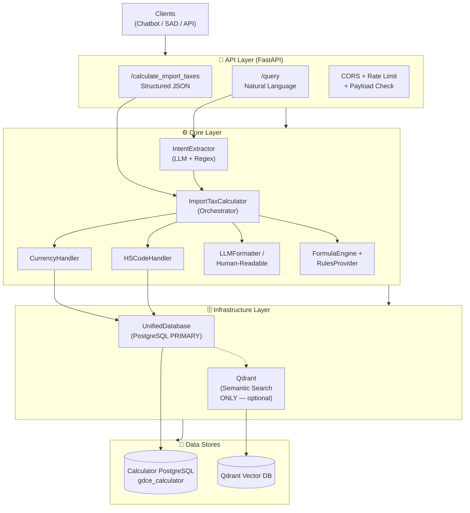

# GDCE Calculator Service — Architecture Overview

> **Version:** 2.0 | **Last Updated:** 2026-07-04

---

## Diagram 1: System Architecture



### Legend

| Symbol | Meaning |
|--------|---------|
| **Solid arrows** | Primary data flow (calculation path) |
| **Dashed arrows** | Optional / fallback flow |

---

## Diagram 2: Request Processing Flow

```mermaid
```

### Key Decision Points

| Step | Decision | Outcome |
|------|----------|---------|
| **Endpoint** | Structured JSON vs Natural Language | JSON goes direct; NL goes through intent extraction |
| **Currency** | Provided? | Infer from origin → default KHR if missing |
| **HS Code** | Prefix / Description / Exact | Resolve to 8-digit with chapter-mismatch guard |
| **Case** | HS prefix + flags + regime | Select 1 of 5 calculation formulas |
| **Rounding** | Always | CEILING to nearest 100 KHR for final payable |

---

## Quick Reference: 5 Calculation Cases

| Case | Trigger | Taxes |
|------|---------|-------|
| **Normal** | Default import | COP + SOP + VOP (+ VVF for vehicles) |
| **Petroleum** | HS 27xx + volume (L) | CPP + ATP + SPP + VPP (two-phase, DV vs CIF) |
| **Rubber** | Export + HS 40xx | ETR (Export Tax on Rubber) |
| **FTA/DV** | FTA certificate or DV=0 | Preferential rates + Original Amounts for base build-up |
| **FTA/DV+DQ** | FTA + DQ factor | Above + DQ discount + BUR (Build-Up Rebate) |

---

*End of Document*
