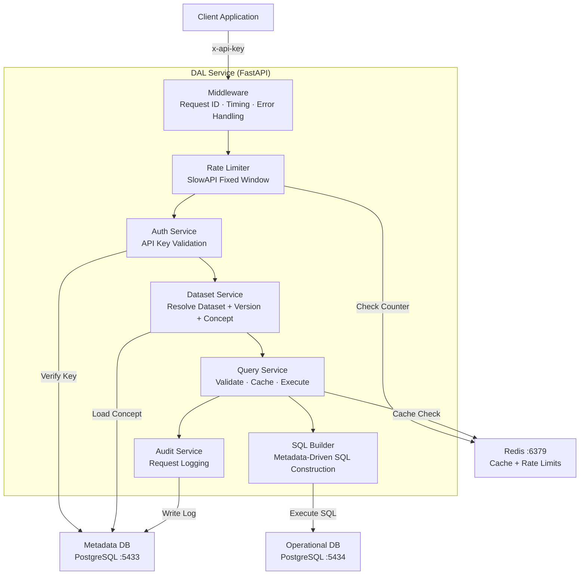
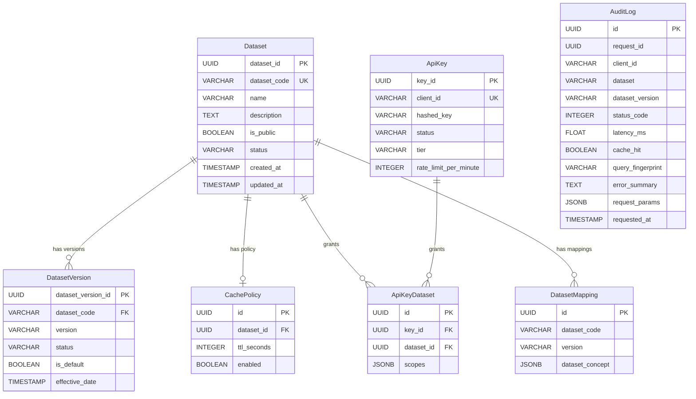
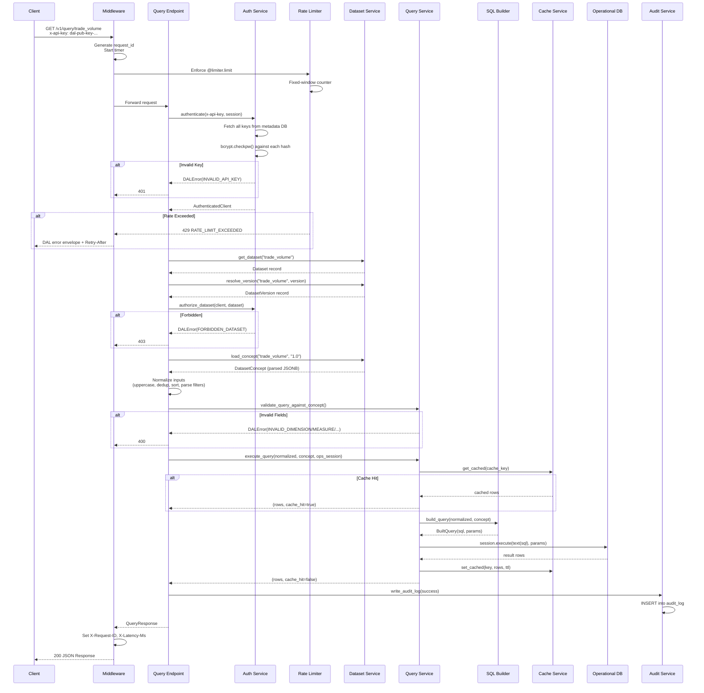
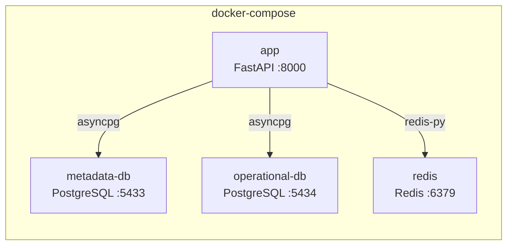

# DAL — Data Access Layer: Development Document

> **Version:** 0.1.0 | **Python:** 3.12+ | **Framework:** FastAPI | **Generated:** 2026-04-29

---

## Table of Contents

1. [Overview](#1-overview)
2. [Architecture](#2-architecture)
3. [Project Structure](#3-project-structure)
4. [Core Modules](#4-core-modules)
5. [Database Schema](#5-database-schema)
6. [Request Lifecycle Flow](#6-request-lifecycle-flow)
7. [API Reference](#7-api-reference)
8. [Configuration](#8-configuration)
9. [Deployment](#9-deployment)
10. [Testing Strategy](#10-testing-strategy)

---

## 1. Overview

The **Data Access Layer (DAL)** is a production-grade, metadata-driven query API built with FastAPI. It serves as a secure proxy between client applications and an operational PostgreSQL database. Instead of accepting raw SQL, the DAL constructs safe queries from **metadata concepts** stored as JSONB — enforcing strict access control, field validation, and SQL injection prevention at every layer.

### Key Capabilities

| Capability | Description |
|---|---|
| **Metadata-Driven Queries** | SQL is built entirely from pre-defined metadata fragments; no user SQL accepted |
| **API Key Authentication** | bcrypt-hashed keys with per-key rate limits and tier support |
| **Dataset Access Control** | Public/private dataset model with scope-based authorization |
| **Redis Caching** | Deterministic cache keys with configurable per-dataset TTL |
| **Fixed-Window Rate Limiting (SlowAPI)** | Redis-backed per-client rate limiter keyed by `x-api-key` |
| **Audit Logging** | Every request (success or failure) is persisted to the metadata DB |
| **Structured JSON Logging** | Production-ready observability with `python-json-logger` |

---

## 2. Architecture

### High-Level Architecture



### Dual-Database Design

| Database | Port | Purpose | Managed By |
|---|---|---|---|
| **Metadata DB** | 5433 | Stores datasets, versions, concepts, API keys, audit logs, cache policies | Alembic migrations |
| **Operational DB** | 5434 | Contains actual business data (e.g. `trade_data`) | Seed scripts (raw SQL) |

> [!IMPORTANT]
> The two databases are intentionally separated. The metadata DB is the DAL's internal control plane; the operational DB is the data plane that clients query through the DAL.

---

## 3. Project Structure

```
dal/
├── app/
│   ├── main.py                      # Application factory (create_app)
│   ├── api/
│   │   ├── deps.py                  # Shared FastAPI dependencies (sessions, auth)
│   │   └── v1/
│   │       ├── router.py            # V1 router aggregator
│   │       └── endpoints/
│   │           ├── health.py        # GET /health/live, /health/ready
│   │           ├── query.py         # GET /v1/query/{dataset}
│   │           └── metadata.py      # GET /v1/metadata/datasets
│   ├── core/
│   │   ├── config.py               # Pydantic Settings (env-based)
│   │   ├── security.py             # bcrypt hash/verify helpers
│   │   ├── middleware.py           # Request ID, timing, error handling
│   │   ├── errors.py              # ErrorCode enum + DALError exception
│   │   ├── cache.py               # Redis connection factory
│   │   ├── rate_limit.py          # SlowAPI limiter + custom 429 handler
│   │   └── logging.py            # Structured JSON logging setup
│   ├── db/
│   │   ├── metadata_session.py    # Async engine + session for metadata DB
│   │   ├── operational_session.py # Async engine + session for operational DB
│   │   └── models/
│   │       └── __init__.py        # All SQLAlchemy ORM models
│   ├── schemas/
│   │   ├── auth.py                # AuthenticatedClient DTO
│   │   ├── metadata.py           # DatasetConcept + nested Pydantic models
│   │   ├── query.py              # NormalizedQuery, FilterItem, SortItem
│   │   └── response.py           # QueryResponse, ErrorResponse envelopes
│   ├── services/
│   │   ├── auth_service.py       # authenticate() + authorize_dataset()
│   │   ├── dataset_service.py    # get_dataset(), resolve_version(), load_concept()
│   │   ├── query_service.py      # validate + execute with caching
│   │   ├── sql_builder.py        # Metadata-driven SQL construction
│   │   ├── metadata_service.py   # Cache policy + dataset listing
│   │   ├── cache_service.py      # Redis get/set for query results
│   │   └── audit_service.py      # Write audit log records
│   └── utils/
│       ├── filter_parser.py      # Parse "FIELD:op:value" filter strings
│       ├── hashing.py            # SHA-256 cache keys + query fingerprints
│       ├── normalization.py      # Input normalization (upper-case, dedup, sort)
│       └── period_parser.py      # Period splitter
├── scripts/
│   ├── start.sh                  # Entrypoint: migrate → seed → start
│   ├── seed_metadata.py          # Seed metadata DB (datasets, keys, etc.)
│   └── seed_operational.py       # Seed operational DB (trade_data tables)
├── tests/
│   ├── unit/                     # 6 test modules (parser, builder, etc.)
│   ├── integration/              # 3 test modules (endpoint, audit, rate limit)
│   └── contract/                 # 1 test module (response envelope)
├── alembic/                      # Database migrations
├── docker-compose.yml            # Full stack: app + 2× PostgreSQL + Redis
├── Dockerfile                    # Python 3.12-slim container
├── pyproject.toml                # Dependencies and tool config
└── .env.example                  # Environment variable template
```

---

## 4. Core Modules

### 4.1 Application Factory — [main.py](file:///d:/dev/data-explorer-project/dal/app/main.py)

- Uses `asynccontextmanager` lifespan for startup/shutdown hooks
- Registers middleware, exception handlers, and v1 router
- Exposes docs at `/docs` and `/redoc` (togglable via `DOCS_ENABLED`)

### 4.2 Configuration — [config.py](file:///d:/dev/data-explorer-project/dal/app/core/config.py)

- `pydantic_settings.BaseSettings` loaded from `.env`
- Computed properties for DB URLs (`postgresql+asyncpg://...`), Redis URL
- Singleton via `@lru_cache` on `get_settings()`

### 4.3 Error System — [errors.py](file:///d:/dev/data-explorer-project/dal/app/core/errors.py)

- `ErrorCode` enum with 15 canonical codes (auth, dataset, query validation, internal)
- `DALError(HTTPException)` maps each code to an HTTP status via `_STATUS_MAP`
- All errors produce a consistent `{request_id, error: {code, message}}` envelope

### 4.4 Middleware — [middleware.py](file:///d:/dev/data-explorer-project/dal/app/core/middleware.py)

- Generates UUID `request_id` per request
- Measures latency with `time.perf_counter()`
- Catches `DALError` and unhandled exceptions → structured JSON response
- Sets `X-Request-ID` and `X-Latency-Ms` response headers

### 4.5 Authentication — [auth_service.py](file:///d:/dev/data-explorer-project/dal/app/services/auth_service.py)

- `authenticate()`: validates `x-api-key` header against bcrypt hashes in DB
- `authorize_dataset()`: public datasets → any valid key; private → explicit grant required
- Returns `AuthenticatedClient` DTO with scopes, rate limits, accessible dataset IDs

### 4.6 SQL Builder — [sql_builder.py](file:///d:/dev/data-explorer-project/dal/app/services/sql_builder.py)

The **heart of the system**. Constructs SQL from metadata only:

- **SELECT**: period expression (from `concept.period.query.case`), frequency literal, dimension columns (`dim.query`), aggregated measures (`SUM(meas.query)`)
- **FROM**: `source.schema.table` with optional JOINs
- **WHERE**: period filters (pattern-matched), dimension filters (parameterized)
- **GROUP BY**: all non-aggregate columns
- **ORDER BY**: dimensions, measures, or period
- **LIMIT/OFFSET**: always parameterized

> [!TIP]
> User values are **never** interpolated into SQL. All filter values use `:param_name` bind parameters. Period filters use metadata-defined SQL templates.

### 4.7 Cache Service — [cache_service.py](file:///d:/dev/data-explorer-project/dal/app/services/cache_service.py)

- JSON serialization to Redis with configurable TTL
- Public datasets share cache keys; private datasets include `client_id` in the key
- Graceful degradation: cache errors are logged but never block the request

### 4.8 Audit Service — [audit_service.py](file:///d:/dev/data-explorer-project/dal/app/services/audit_service.py)

- Persists every request to `audit_log` table
- Records: request_id, client_id, dataset, version, status_code, latency, cache_hit, query fingerprint, errors, full request params (JSONB)

### 4.9 Rate Limiting — [rate_limit.py](file:///d:/dev/data-explorer-project/dal/app/core/rate_limit.py)

- Uses `SlowAPI` `Limiter` with Redis storage (`storage_uri=settings.redis_url`)
- Client key function uses `x-api-key` and falls back to client IP when missing
- Default limit is generated from `DEFAULT_RATE_LIMIT_PER_MINUTE` as `{N}/minute`
- Strategy is `fixed-window`
- Custom `RateLimitExceeded` handler returns DAL-standard envelope:
    - `error.code = RATE_LIMIT_EXCEEDED`
    - HTTP 429 with `Retry-After: 60`

---

## 5. Database Schema

### 5.1 Metadata Database ER Diagram



### 5.2 Operational Database (Sample: `trade_volume`)

| Table | Purpose |
|---|---|
| `trade_data` | Fact table — monthly trade records with value, weight, quantity |
| `countries` | Dimension — country code → name mapping |
| `mode_of_transport` | Dimension — transport mode code → name mapping |

### 5.3 Dataset Concept (JSONB Structure)

The `dataset_mapping.dataset_concept` column stores the full query blueprint:

```json
{
  "dataset_code": "trade_volume",
  "version": "1.0",
  "frequency": { "code": "FREQ", "default": "A", "query": { "base": "FREQ", "case": {...} } },
  "period": { "code": "PERIOD", "query": { "case": { "a": "td.ref_year::TEXT", "m": "..." } }, "filters": { "start-period": { "pattern-test": {...}, "query": {...} } } },
  "dimensions": [ { "code": "PARTNER_COUNTRY", "query": "c.name_en" } ],
  "measures": [ { "code": "VALUE_USD", "query": "td.value_usd", "aggregate": "SUM" } ],
  "source": { "schema": "public", "table": "trade_data as td", "join": [...] },
  "filters": { "partner_country": { "query": "c.country_code" } },
  "security": { "allow_raw_sql": false }
}
```

---

## 6. Request Lifecycle Flow

### 6.1 Main Query Flow — `GET /v1/query/{dataset}`



### 6.2 Step-by-Step Summary

| # | Step | Module | Failure Mode |
|---|---|---|---|
| 1 | **Middleware** injects `request_id`, starts timer | `middleware.py` | 500 on unhandled error |
| 2 | **Authenticate** — validate `x-api-key` via bcrypt | `auth_service.py` | 401 MISSING/INVALID_API_KEY |
| 3 | **Rate Limit** — SlowAPI fixed-window check (`x-api-key`) | `rate_limit.py` | 429 RATE_LIMIT_EXCEEDED |
| 4 | **Resolve Dataset** — lookup by code, must be active | `dataset_service.py` | 404 DATASET_NOT_FOUND |
| 5 | **Resolve Version** — explicit or default version | `dataset_service.py` | 404 VERSION_NOT_FOUND |
| 6 | **Authorize** — check public/private + scopes | `auth_service.py` | 403 FORBIDDEN_DATASET |
| 7 | **Load Concept** — parse JSONB into `DatasetConcept` | `dataset_service.py` | 500 parse failure |
| 8 | **Normalize** — uppercase, dedup, sort, parse filters | `normalization.py`, `filter_parser.py` | 400 INVALID_FILTER |
| 9 | **Validate** — check dims/measures/freq against concept | `query_service.py` | 400 INVALID_DIMENSION etc. |
| 10 | **Cache Check** — compute SHA-256 key, check Redis | `cache_service.py` | Graceful fallback |
| 11 | **Build SQL** — construct from metadata fragments only | `sql_builder.py` | 400/500 |
| 12 | **Execute** — run parameterized SQL on operational DB | `query_service.py` | 500 INTERNAL_ERROR |
| 13 | **Cache Store** — persist results to Redis with TTL | `cache_service.py` | Graceful fallback |
| 14 | **Audit Log** — persist request record to metadata DB | `audit_service.py` | Logged, never blocks |
| 15 | **Response** — structured `QueryResponse` envelope | `response.py` | — |

---

## 7. API Reference

### 7.1 `GET /v1/query/{dataset}`

**Primary data query endpoint.** All fields validated against dataset concept.

| Parameter | Type | Required | Description |
|---|---|---|---|
| `dataset` | path | ✅ | Dataset code (e.g. `trade_volume`) |
| `dimensions` | query | ✅ | Comma-separated dimension codes |
| `measures` | query | ✅ | Comma-separated measure codes |
| `version` | query | ❌ | Dataset version (default: default version) |
| `start-period` | query | ❌ | Start period (e.g. `2025`, `2025-01`, `2025-Q1`) |
| `end-period` | query | ❌ | End period |
| `period` | query | ❌ | Combine period (eg: `2025`, `2025-2026`) |
| `frequency` | query | ❌ | `A`, `S`, `Q`, `M` (default: from concept) |
| `filter` | query | ❌ | Repeatable `FIELD:op:value` (ops: eq,ne,gt,ge,lt,le,in,like) |
| `sort` | query | ❌ | `FIELD:asc` or `FIELD:desc` |
| `limit` | query | ❌ | Max rows (default 100, max 10000) |
| `offset` | query | ❌ | Rows to skip |

**Headers:** `x-api-key` (required)

**Example:**
```
GET /v1/query/trade_volume?dimensions=FREQ,PARTNER_COUNTRY,FLOW&measures=VALUE_USD&start-period=2025&end-period=2026&frequency=A&filter=PARTNER_COUNTRY:eq:US&limit=10
x-api-key: dal-pub-key-abc123xyz789
```

**Success Response (200):**
```json
{
  "request_id": "uuid",
  "dataset": "trade_volume",
  "version": "1.0",
  "frequency": "A",
  "dimensions": ["FLOW", "FREQ", "PARTNER_COUNTRY"],
  "measures": ["VALUE_USD"],
  "period": { "from": "2025", "to": "2026" },
  "pagination": { "limit": 10, "offset": 0 },
  "cache": { "hit": false, "ttl_seconds": 300 },
  "meta": { "latency_ms": 45.2 },
  "row_count": 2,
  "data": [
    { "PERIOD": "2025", "FREQ": "A", "PARTNER_COUNTRY": "United States", "FLOW": "IMPORT", "VALUE_USD": 12345678.00 }
  ]
}
```

### 7.2 `GET /v1/metadata/datasets`

Lists all active datasets. Requires valid API key.

### 7.3 `GET /v1/metadata/dataset/{dataset}`

Returns metadata details for a single dataset (frequency, dimensions, measures, and period metadata).

**Path params:**
- `dataset` (required) — dataset code, allowed pattern: `^[A-Za-z0-9_-]+$`

**Query params:**
- `version` (optional) — dataset version, e.g. `1.0` (defaults to configured default version)

**Headers:** `x-api-key` (required)

**Responses:**
- `200` dataset metadata payload
- `401` missing/invalid API key
- `403` dataset access denied
- `404` dataset not found
- `422` invalid route/path parameter
- `429` rate limit exceeded
- `500` internal error

### 7.4 `GET /health/live`

Returns `{"status": "ok"}` — liveness probe.

### 7.5 `GET /health/ready`

Checks metadata DB, operational DB, and Redis connectivity. Returns 200 or 503.

### 7.6 Rate Limiting Behavior

- Endpoints are decorated with `@limiter.limit(f"{DEFAULT_RATE_LIMIT_PER_MINUTE}/minute")`
- Current protected routes include:
    - `/v1/query/{dataset}`
    - `/v1/metadata/datasets`
    - `/v1/metadata/dataset/{dataset}`
    - `/health/live`
    - `/health/ready`
- Exceeded requests return HTTP 429 with the DAL error envelope and `Retry-After: 60`

### 7.7 Metadata CRUD Endpoints

Metadata admin-style CRUD routes are exposed per metadata table under `/v1/crud`:

- `POST /v1/crud/{table}`
- `GET /v1/crud/{table}`
- `GET /v1/crud/{table}/{item_id}`
- `PATCH /v1/crud/{table}/{item_id}`
- `DELETE /v1/crud/{table}/{item_id}`

Supported `{table}` values:

- `dataset`
- `dataset-version`
- `dataset-mapping`
- `api-key`
- `api-key-dataset`
- `cache-policy`
- `audit-log`

All CRUD routes require a valid `x-api-key` and use the default per-minute rate limit.

---

## 8. Configuration

All configuration via environment variables (loaded from `.env`):

| Variable | Default | Description |
|---|---|---|
| `APP_ENV` | `development` | Environment name |
| `DEBUG` | `false` | Enable SQLAlchemy echo, verbose logging |
| `LOG_LEVEL` | `INFO` | Root log level |
| `DOCS_ENABLED` | `true` | Expose `/docs` and `/redoc` |
| `METADATA_DB_HOST/PORT/USER/PASSWORD/NAME` | localhost:5433 | Metadata PostgreSQL |
| `OPERATIONAL_DB_HOST/PORT/USER/PASSWORD/NAME` | localhost:5434 | Operational PostgreSQL |
| `REDIS_HOST/PORT/DB/PASSWORD` | localhost:6379 | Redis |
| `DEFAULT_RATE_LIMIT_PER_MINUTE` | `10` | Default `SlowAPI` per-minute limit (`{N}/minute`) |
| `DEFAULT_QUERY_LIMIT` | `100` | Default row limit |
| `MAX_QUERY_LIMIT` | `10000` | Maximum row limit |

---

## 9. Deployment

### 9.1 Docker Compose Stack



**Start:** `docker-compose up --build`

### 9.2 Startup Sequence (scripts/start.sh)

1. `alembic upgrade head` — run metadata DB migrations
2. `python -m scripts.seed_metadata` — seed datasets, API keys, concepts
3. `python -m scripts.seed_operational` — create tables + seed trade data
4. `uvicorn app.main:app --host 0.0.0.0 --port 8000`

### 9.3 Seed Data

| Item | Details |
|---|---|
| Dataset | `trade_volume` (public, version 1.0) |
| API Keys | `dal-pub-key-abc123xyz789` (standard), `dal-priv-key-def456uvw012` (premium) |
| Trade Data | ~40 rows spanning 2025-Q1 to 2026-Q2, 10 countries, 6 transport modes |
| Cache Policy | Enabled, 300s TTL |

---

## 10. Testing Strategy

### Test Pyramid

| Layer | Directory | Count | Scope |
|---|---|---|---|
| **Unit** | `tests/unit/` | 6 modules | Parsers, SQL builder, normalization, cache keys, auth logic |
| **Integration** | `tests/integration/` | 3 modules | Full endpoint flow, audit logging, rate limiting |
| **Contract** | `tests/contract/` | 1 module | Response envelope schema validation |

**Run:** `pytest` (asyncio_mode = auto)

### Key Test Modules

- `test_sql_builder.py` — Verifies SQL construction from concept metadata
- `test_filter_parser.py` — Filter string parsing edge cases
- `test_period_parser.py` — Period format matching + SQL generation
- `test_query_endpoint.py` — Full integration: auth → query → response
- `test_response_envelope.py` — Contract: response schema compliance

---

> [!NOTE]
> **Dependencies:** FastAPI, SQLAlchemy (async), asyncpg, Redis (hiredis), bcrypt, Pydantic Settings, Alembic, python-json-logger. Dev: pytest, pytest-asyncio, ruff.
