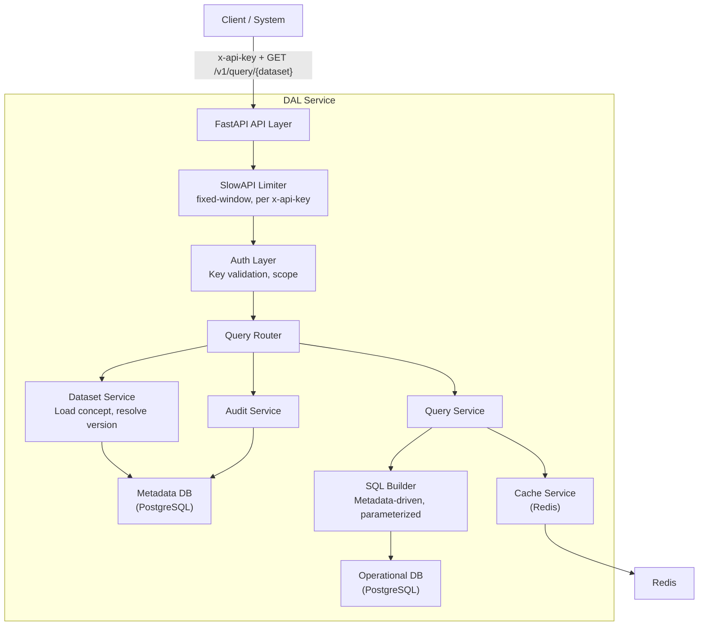
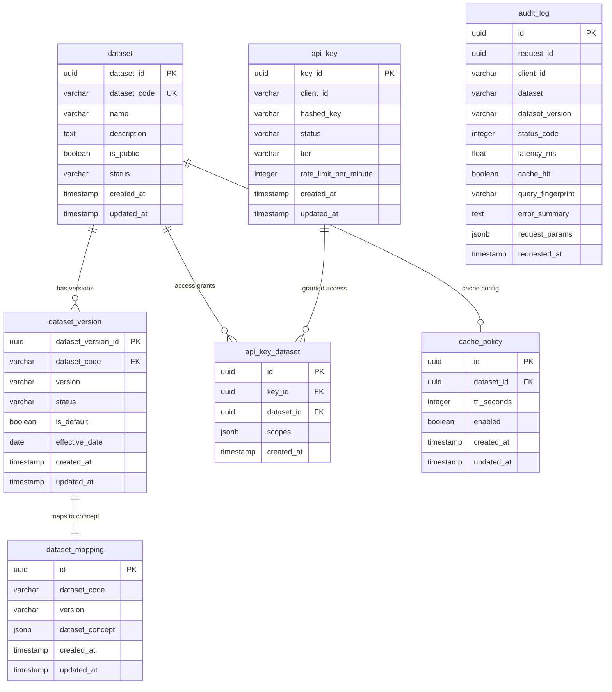

# DAL — Implementation Plan

## 1. Architecture Overview



**Key design decisions:**
- Two isolated PostgreSQL connections — metadata vs. operational
- SQL is never user-supplied; the SQL builder only emits fragments from metadata + parameterized values
- Redis serves dual purpose: caching query results + SlowAPI rate-limit counters
- All request processing is async (asyncpg + aioredis)
- Fail-closed: unrecognized fields are rejected

## 2. Final Folder Structure

```
dal/
├── app/
│   ├── __init__.py
│   ├── main.py                        # FastAPI app factory
│   ├── api/
│   │   ├── __init__.py
│   │   ├── deps.py                    # Shared dependencies (get_db, get_redis, etc.)
│   │   └── v1/
│   │       ├── __init__.py
│   │       ├── router.py              # v1 router aggregator
│   │       └── endpoints/
│   │           ├── __init__.py
│   │           ├── query.py
│   │           ├── health.py
│   │           └── metadata.py
│   ├── core/
│   │   ├── __init__.py
│   │   ├── config.py                  # Pydantic Settings
│   │   ├── logging.py                 # Structured logging setup
│   │   ├── security.py                # Key hashing helpers
│   │   ├── errors.py                  # Unified error codes & exceptions
│   │   ├── middleware.py              # Request-ID, timing, error handler
│   │   ├── cache.py                   # Redis connection factory
│   │   └── rate_limit.py             # SlowAPI limiter config + custom 429 handler
│   ├── db/
│   │   ├── __init__.py
│   │   ├── metadata_session.py        # Async engine + session for metadata DB
│   │   ├── operational_session.py     # Async engine + session for operational DB
│   │   └── models/
│   │       ├── __init__.py
│   │       ├── dataset.py
│   │       ├── api_key.py
│   │       ├── cache_policy.py
│   │       └── audit_log.py
│   ├── schemas/
│   │   ├── __init__.py
│   │   ├── query.py                   # QueryRequest, parsed internal model
│   │   ├── response.py               # Success/Error envelopes
│   │   ├── auth.py                    # API key DTOs
│   │   └── metadata.py               # Dataset concept Pydantic models
│   ├── services/
│   │   ├── __init__.py
│   │   ├── auth_service.py
│   │   ├── dataset_service.py
│   │   ├── query_service.py           # Orchestrator
│   │   ├── sql_builder.py             # Metadata-driven SQL compiler
│   │   ├── cache_service.py
│   │   ├── audit_service.py
│   │   └── metadata_service.py
│   └── utils/
│       ├── __init__.py
│       ├── normalization.py
│       ├── hashing.py
│       ├── period_parser.py
│       └── filter_parser.py
├── tests/
│   ├── __init__.py
│   ├── conftest.py                    # Shared fixtures
│   ├── unit/
│   │   ├── __init__.py
│   │   ├── test_auth_service.py
│   │   ├── test_filter_parser.py
│   │   ├── test_period_parser.py
│   │   ├── test_cache_key.py
│   │   ├── test_sql_builder.py
│   │   └── test_normalization.py
│   ├── integration/
│   │   ├── __init__.py
│   │   ├── test_query_endpoint.py
│   │   ├── test_auth_flow.py
│   │   ├── test_rate_limit.py
│   │   ├── test_cache.py
│   │   └── test_audit.py
│   ├── contract/
│   │   ├── __init__.py
│   │   ├── test_response_envelope.py
│   │   └── test_openapi_schema.py
│   └── fixtures/
│       ├── __init__.py
│       ├── sample_concept.py
│       └── sample_keys.py
├── scripts/
│   ├── seed_metadata.py
│   └── seed_operational.py
├── alembic/
│   ├── env.py
│   ├── script.py.mako
│   └── versions/
├── alembic.ini
├── Dockerfile
├── docker-compose.yml
├── pyproject.toml
├── .env.example
└── README.md
```

## 3. Dependencies

| Package | Purpose |
|---|---|
| `fastapi[standard]` | Web framework + Uvicorn |
| `pydantic-settings` | Env-based configuration |
| `sqlalchemy[asyncio]` | ORM, 2.0 style |
| `asyncpg` | Async PostgreSQL driver |
| `alembic` | Database migrations |
| `redis[hiredis]` | Async Redis client |
| `slowapi` | Middleware/decorator-based rate limiting |
| `bcrypt` | API key hashing |
| `python-json-logger` | Structured logging |
| `httpx` | Test client |
| `pytest` / `pytest-asyncio` | Testing |

## 4. Metadata Schema Design



## 5. Request / Response Contract

### Request: `GET /v1/query/{dataset}`

| Parameter | In | Type | Required | Example |
|---|---|---|---|---|
| `dataset` | path | string | yes | `trade_volume` |
| `version` | query | string | no | `1.0` |
| `dimensions` | query | string (CSV) | yes | `FREQ,PARTNER_COUNTRY,FLOW` |
| `measures` | query | string (CSV) | yes | `VALUE_USD,NETWEIGHT` |
| `start-period` | query | string | no | `2025-Q1` |
| `end-period` | query | string | no | `2026-Q2` |
| `frequency` | query | string | no | `M` |
| `filter` | query | list[string] | no | `PARTNER_COUNTRY:eq:US` (repeatable) |
| `sort` | query | string | no | `FLOW:desc` |
| `limit` | query | int | no | `100` (default 100, max 10000) |
| `offset` | query | int | no | `0` |

### Internal Normalized Request Model

```python
class NormalizedQuery:
    dataset: str
    version: str          # resolved from default if omitted
    frequency: str        # resolved from concept default if omitted
    dimensions: list[str] # upper-cased, validated
    measures: list[str]   # upper-cased, validated
    period_from: str | None
    period_to: str | None
    filters: list[Filter] # parsed from "FIELD:op:value"
    sort: list[SortField] # parsed from "FIELD:dir"
    limit: int            # clamped to max
    offset: int
```

### Success Response (200)

```json
{
  "request_id": "uuid",
  "dataset": "trade_volume",
  "version": "1.0",
  "frequency": "M",
  "dimensions": ["FREQ", "PARTNER_COUNTRY", "FLOW"],
  "measures": ["VALUE_USD", "NETWEIGHT"],
  "period": { "from": "2025-Q1", "to": "2026-Q2" },
  "pagination": { "limit": 100, "offset": 0 },
  "cache": { "hit": true, "ttl_seconds": 300 },
  "meta": { "latency_ms": 42 },
  "row_count": 2,
  "data": [...]
}
```

### Error Response (4xx/5xx)

```json
{
  "request_id": "uuid",
  "error": {
    "code": "FORBIDDEN_DATASET",
    "message": "API key is not allowed to access this dataset"
  }
}
```

## 6. Build Phases

| Phase | Deliverable | Status |
|---|---|---|
| 1 | Project scaffold, config, pyproject.toml, Docker files | ✅ |
| 2 | DB models + Alembic migrations | ✅ |
| 3 | Auth service + API key model | ✅ |
| 4 | Metadata loading + concept parsing | ✅ |
| 5 | SQL builder / query engine | ✅ |
| 6 | Cache + SlowAPI limiter | ✅ |
| 7 | API endpoints + OpenAPI docs | ✅ |
| 8 | Tests (unit, integration, contract) | ✅ (77 unit + 6 contract = 83 passing) |
| 9 | Seed scripts + README | ✅ |
| 10 | Final hardening | ⬜ |
