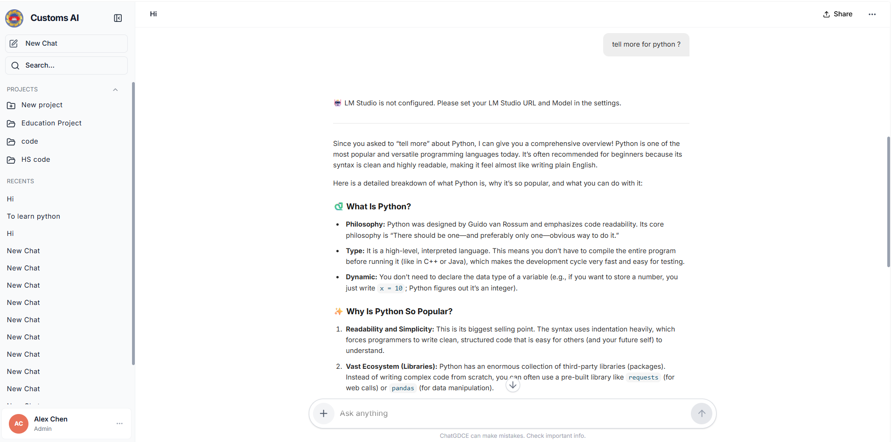
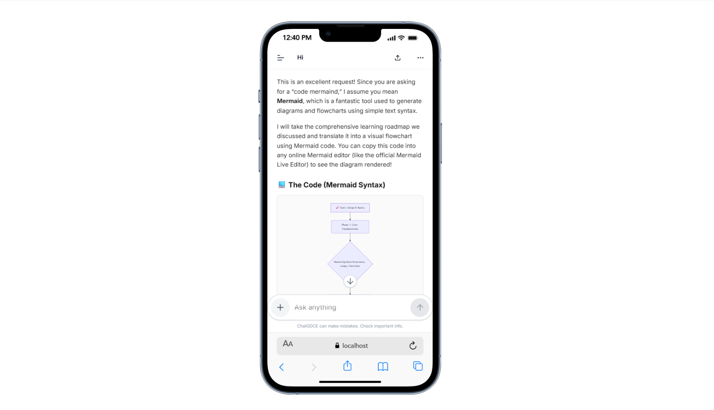
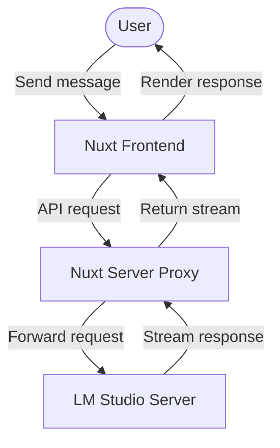

# GDCE Chatbot

A high-performance, modern AI chatbot interface built with **Nuxt**, **Vue**, **Vuetify**, and **Tailwind CSS**. Optimized for local AI workflows using **LM Studio**.

---

---



## 📖 Overview

The **GDCE Chatbot** provides a premium, ChatGPT-style interface designed for complex AI interactions. It supports advanced rendering for Markdown, code blocks, diagrams, and charts.

### Key Goals:
- ⚡ **Performance**: Optimized frontend with Nuxt SSR-ready architecture.
- 🧩 **Modularity**: Scalable project structure with reusable base components.
- 🔒 **Security**: Secure server-side proxying for local AI communication.
- 🎨 **Aesthetics**: Professional UI blending Vuetify logic with Tailwind's design flexibility.

---

## 🚀 Architecture Flow

The following diagram illustrates how the application communicates with the local AI model through the secure server-side proxy:



---

## 🛠️ Technology Stack

| Category | Technology | Purpose |
| :--- | :--- | :--- |
| **Framework** | [Nuxt](https://nuxt.com/) | Main Vue framework with Nitro engine |
| **Frontend** | [Vue 3](https://vuejs.org/) | Component-based UI logic |
| **UI Framework** | [Vuetify](https://vuetifyjs.com/) | Accessible Dialogs, Menus, and Layouts |
| **Styling** | [Tailwind CSS](https://tailwindcss.com/) | Custom layout, spacing, and modern design |
| **State** | [Pinia](https://pinia.vuejs.org/) | Chat history and settings management |
| **Language** | [TypeScript](https://www.typescriptlang.org/) | Type-safe, maintainable codebase |
| **Icons** | [Lucide Vue](https://lucide.dev/) | Consistent, modern SVG icon set |
| **AI Server** | [LM Studio](https://lmstudio.ai/) | Local AI model server (OpenAI-compatible) |
| **Markdown** | [Markdown-it](https://github.com/markdown-it/markdown-it) | Robust AI response rendering |
| **Security** | [DOMPurify](https://github.com/cure53/dompurify) | HTML sanitization for AI output |
| **Syntax** | [Shiki](https://shiki.style/) | Professional-grade code block highlighting |
| **Visuals** | [Mermaid.js](https://mermaid.js.org/) & [ECharts](https://echarts.apache.org/) | Live diagrams and data visualization |
| **Dates** | [Date-fns](https://date-fns.org/) | Precise date formatting and utilities |

---

## 📂 Project Structure

```text
├── .vscode/                  # VS Code workspace settings
├── app/                      # Main application source
│   ├── assets/               # Global styles, Tailwind, and Vuetify SASS
│   ├── components/
│   │   ├── base/             # Reusable atomic UI (BaseDialog, BaseButton, etc.)
│   │   ├── chat/             # Chat UI logic: input, messages, renderers
│   │   └── navbar/           # Navigation and layout components
│   ├── composables/
│   │   ├── chat/             # Chat logic: streaming, typing, persistence
│   │   └── index.ts          # Composable exports
│   ├── layouts/              # Nuxt layouts (Default, Empty)
│   ├── pages/                # Application routes and views
│   ├── plugins/              # Nuxt plugins (Vuetify, etc.)
│   ├── stores/               # Pinia state management
│   ├── types/                # TypeScript interfaces and types
│   ├── utils/                # Helper functions and utilities
│   └── app.vue               # Root application entry point
├── docs/                     # Documentation and integration guides
├── public/                   # Static files (Favicons, assets)
├── server/
│   └── api/
│       └── lmstudio/         # Server-side proxy for LM Studio
├── .env.example              # Environment template
├── nuxt.config.ts            # Nuxt configuration
├── package.json              # Dependencies and scripts
├── prettier.config.mjs       # Code formatting rules
└── tsconfig.json             # TypeScript configuration
```

---

## 💡 Core Concepts

### 1. Hybrid Styling Pattern
We blend **Vuetify** for its robust logic (Dialogs, Menus, Overlays) with **Tailwind CSS** for custom visuals. This ensures the app feels unique and premium while maintaining full accessibility.

### 2. Base Component Architecture
Core UI elements are encapsulated in `app/components/base/`. 
- **Consistency**: Updates to `BaseCard.vue` apply across the entire app.
- **Maintainability**: Lowers code duplication and keeps features clean.

### 3. Server Proxy Pattern
To avoid **CORS** issues with local AI servers, all requests are routed through `/api/lmstudio/*`. The Nuxt server handles the communication with your local IP securely.

---

## ⚙️ Setup & Development

### Requirements
- **Node.js**: v18+ 
- **pnpm**: Recommended package manager
- **LM Studio**: Running locally with the server enabled

### Installation
```bash
# Clone the repository
git clone https://github.com/Kimheang-code-IT/Chat-Bot-GDCE.git
cd Chat-Bot-GDCE

# Install dependencies
pnpm install
```

### Configuration
Create a `.env` file from the template:
```bash
cp .env.example .env
```
Ensure your model ID and URL are correct:
```env
NUXT_LM_STUDIO_UPSTREAM_URL=http://localhost:1234
NUXT_PUBLIC_LM_STUDIO_MODEL=your-model-id
```

### Development
```bash
# Start the dev server
pnpm dev
```
Visit [http://localhost:3000](http://localhost:3000) to start chatting.

---

## 🔄 Git Workflow & Branching

For the best experience, we recommend using the **`customs-chatbot-system`** branch for the latest stable code.

### Switching Branches
```bash
git fetch origin
git switch customs-chatbot-system
git pull origin customs-chatbot-system
```

### Recommended Branch Cleanup
To keep the repository clean, only keep `main` and `customs-chatbot-system`. You can delete older feature branches:
```bash
# Delete remote branches
git push origin --delete Kimheang/navbar
git push origin --delete Kimheang/setup-pinai
git push origin --delete Kimheang/version-1
git push origin --delete Kimheang/renderer-with-bot

# Prune local references
git fetch --prune
```

---

## 📜 Scripts

| Script | Description |
| :--- | :--- |
| `pnpm dev` | Run development server |
| `pnpm build` | Build for production |
| `pnpm preview` | Preview production build |
| `pnpm lint` | Run ESLint and check code quality |

---

## 📄 License
Internal GDCE Project.