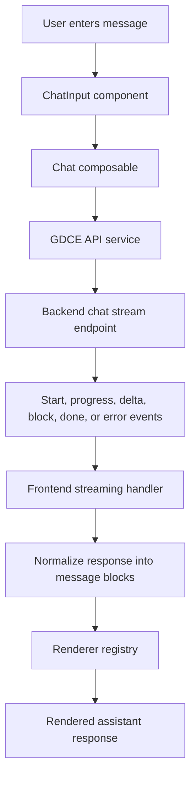
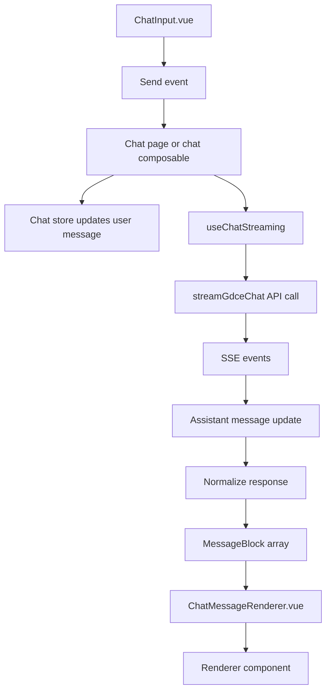
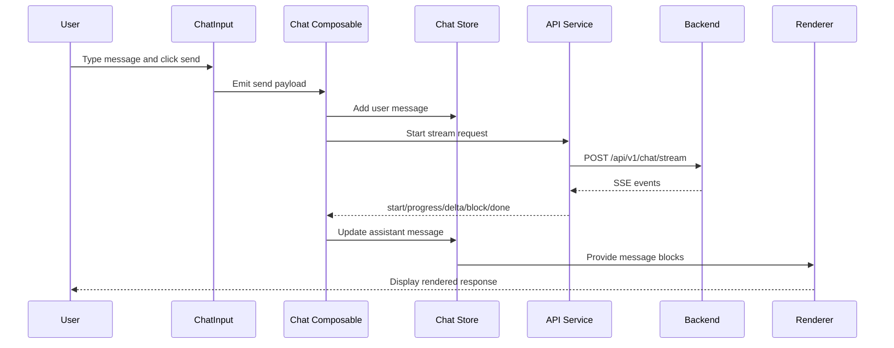

# GDCE Frontend Chatbot Report

## Table of Contents

1. Introduction  
2. Problem Statement  
3. Project Objectives  
4. Project Scope  
5. System Overview  
   5.1. Frontend Chatbot Overview  
   5.2. User Interface Overview  
   5.3. Chat Interaction Overview  
   5.4. API Integration Overview  
6. Research Methodology  
   6.1. Requirement Analysis  
   6.2. UI/UX Research  
   6.3. Technology Selection  
   6.4. API Communication Research  
   6.5. Evaluation Metrics  
7. Frontend Architecture  
   7.1. Application Structure  
   7.2. Component Architecture  
   7.3. Routing  
   7.4. State Management  
   7.5. Frontend Data Flow  
8. User Interface Module  
   8.1. Main Layout  
   8.2. Sidebar  
   8.3. Chat Area  
   8.4. Message Input  
   8.5. Responsive Design  
9. Chat Module  
   9.1. Message Input  
   9.2. Message Validation  
   9.3. Send Message  
   9.4. Receive Response  
   9.5. Response Rendering  
   9.6. Chat Data Flow  
10. Conversation Management  
    10.1. Create Conversation  
    10.2. Conversation History  
    10.3. Select Conversation  
    10.4. Delete Conversation  
11. API Integration  
    11.1. API Service  
    11.2. Request Processing  
    11.3. Response Processing  
    11.4. Error Handling  
12. State Management  
    12.1. Chat State  
    12.2. Message State  
    12.3. Conversation State  
    12.4. Loading and Error State  
13. Frontend Best Practices  
    13.1. Reusable Components  
    13.2. Clean Code Structure  
    13.3. Secure API Communication  
    13.4. Responsive Design  
    13.5. Performance Optimization  
14. System Implementation  
    14.1. Project Setup  
    14.2. UI Implementation  
    14.3. Chat Implementation  
    14.4. API Integration  
    14.5. End-to-End Integration  
15. Testing and Evaluation  
    15.1. UI Testing  
    15.2. Chat Testing  
    15.3. API Testing  
    15.4. Responsive Testing  
    15.5. End-to-End Testing  
16. Results and Discussion  
    16.1. System Results  
    16.2. Key Findings  
    16.3. System Limitations  
17. Deployment  
    17.1. Deployment Overview  
    17.2. Environment Configuration  
    17.3. Frontend Build Process  
    17.4. Environment Variables and API Configuration  
    17.5. Frontend Hosting  
    17.6. CI/CD Integration  
    17.7. Deployment Testing  
    17.8. Production Monitoring and Rollback  
    17.9. Deployment Readiness Checklist  
18. Future Improvements  
    18.1. Voice Input and Voice Response  
    18.2. Image and Multiple-File Input  
    18.3. Multiple AI Models and Response Preferences  
    18.4. Advanced Conversation Search and Export  
    18.5. Message Editing, Regeneration, and Branching  
    18.6. Shared Conversations and Collaboration  
    18.7. English and Khmer Language Coverage  
    18.8. Offline and Resilient Experience  
    18.9. Accessibility and Personalization  
    18.10. Product Analytics and Quality Feedback  
    18.11. Suggested Improvement Roadmap  
19. Conclusion and Recommendations  
20. References  
21. Appendices  
    21.1. Appendix A - Frontend File Map  
    21.2. Appendix B - Requirements Traceability Matrix  
    21.3. Appendix C - Test Execution Record  
    21.4. Appendix D - Screenshot and Figure Register  
    21.5. Appendix E - Final Submission Checklist  

---

## 1. Introduction

The GDCE Frontend Chatbot project is a web-based chatbot interface developed to support digital communication between users and the GDCE artificial intelligence services. The project focuses on the frontend layer of the chatbot system. It provides the user interface, message composition experience, conversation history, response rendering, and communication flow required for users to interact with backend chatbot services.

The frontend was built from scratch using a modern Vue and Nuxt application structure. It is designed as a single page application with modular components, reusable composables, typed data models, and state management through Pinia. The system supports normal assistant messages as well as rich response formats such as Markdown, code blocks, tables, charts, reports, references, reasoning blocks, image blocks, workflow blocks, OCR output, prediction output, and error states.

This report describes the full frontend development process, including the problem being solved, objectives, scope, architecture, implementation, testing, deployment, limitations, and future improvements. Since the chatbot frontend works with other services, the report also explains the API integration layer and how frontend requests and backend responses move through the application.

**Suggested Figure 1.1:** Screenshot of the final chatbot home screen.

## 2. Problem Statement

Modern users expect chatbot systems to be fast, clean, reliable, and easy to use. A chatbot frontend must do more than display plain text. It must support long conversations, loading states, message streaming, copyable content, responsive layouts, errors, rich data output, and secure communication with backend services. Without a well-structured frontend, users may experience confusing conversation flow, poor readability, slow interaction, and difficulty understanding AI-generated results.

The GDCE chatbot also has project-specific needs. It must present GDCE-related answers clearly, support both general assistant responses and structured tool responses, communicate with backend services, and remain maintainable as additional features are added. Because the frontend works with multiple backend capabilities, the application needs a stable response contract and a renderer system that can display different response types without requiring the main chat interface to be rewritten each time.

The main problem addressed by this project is therefore the design and development of a scalable frontend chatbot interface that can receive user input, send requests to backend APIs, display streamed or structured responses, manage conversations, and provide a professional user experience across desktop and mobile devices.

## 3. Project Objectives

The main objective of this project is to build a complete frontend chatbot application for the GDCE system.

The specific objectives are:

1. Develop a responsive chatbot interface using Nuxt, Vue, Vuetify, Tailwind CSS, and TypeScript.
2. Create reusable frontend components for chat messages, input, sidebar, renderers, settings, and common interface elements.
3. Implement conversation management, including creating, selecting, saving, pinning, renaming, moving, and deleting chats.
4. Support message input, file attachment validation, send actions, stop actions, and keyboard shortcuts.
5. Integrate the frontend with GDCE backend chat APIs through typed service modules.
6. Support server-sent events so assistant responses can be displayed progressively.
7. Normalize backend responses into frontend message blocks that can be rendered consistently.
8. Provide rich renderers for Markdown, code, tables, charts, reports, references, images, OCR, predictions, workflow, and error output.
9. Maintain frontend state using Pinia stores and local storage persistence.
10. Improve user experience through loading states, typing indicators, toast notifications, auto-scroll behavior, dark mode support, and multilingual readiness.
11. Test the most important frontend response parsing, streaming, chart, calculator, safety, and API contract behavior.
12. Prepare the application for production build, hosting, configuration, and future improvements.

## 4. Project Scope

The scope of this report is the frontend chatbot application. It includes the user interface, frontend architecture, chat workflow, conversation management, API integration, state management, frontend testing, deployment preparation, and recommended improvements.

The project scope includes:

1. Chatbot landing and chat pages.
2. Sidebar and conversation list.
3. Chat input and file attachment interface.
4. User and assistant message display.
5. Rich response rendering system.
6. Frontend API service layer.
7. Streaming response handling.
8. Local frontend persistence for conversation history.
9. Authentication-aware API request behavior.
10. Responsive layout and dark mode support.
11. Unit testing of important frontend logic.
12. Documentation of screenshots, project structure, and data flow.

The project scope does not include full backend implementation details, AI model training, database administration, or production infrastructure design beyond what is required for frontend deployment and integration. Backend services are discussed only where they affect frontend behavior.

## 5. System Overview

### 5.1. Frontend Chatbot Overview

The frontend chatbot is a Nuxt 4 single page application using Vue 3. It is configured with `ssr: false`, meaning the application is rendered in the browser rather than using server-side rendering. The frontend is responsible for presenting the chatbot interface, accepting user input, calling backend APIs, receiving responses, and displaying the result in a readable format.

The main frontend source code is located under `frontend/app`. The application uses a structured folder layout with components, composables, services, stores, types, utilities, layouts, pages, plugins, and assets. This structure helps separate responsibilities and makes the system easier to maintain.

**Suggested Figure 5.1:** Screenshot of the running chatbot interface with sidebar, chat area, and input bar.

### 5.2. User Interface Overview

The user interface follows a familiar AI chat layout. It contains a sidebar for navigation and recent conversations, a main chat area for messages, and a bottom input area for composing messages. The interface supports light and dark visual themes and is built using Vuetify components together with Tailwind CSS utility classes.

The UI includes:

1. Main layout wrapper.
2. Sidebar with recent chats and projects.
3. Chat welcome state.
4. User message bubbles.
5. Assistant message blocks.
6. Chat input with file upload button and send button.
7. Loading and typing indicators.
8. Toast notifications.
9. Renderer components for structured answers.

### 5.3. Chat Interaction Overview

The chat interaction begins when the user types a message or attaches an allowed image file. The frontend validates whether the message can be sent, creates or uses an active chat, inserts the user message into the message list, and then calls the chat streaming service. While the backend processes the request, the frontend displays an assistant loading state and progressively updates the assistant message as streaming events arrive.

When the final response is received, the frontend normalizes it into one or more message blocks. These blocks are then rendered by the chat renderer registry. This approach allows the system to support many output formats while keeping the main chat component simple.

### 5.4. API Integration Overview

The frontend communicates with GDCE backend APIs using service modules in `frontend/app/services/chat-api`. The main streaming integration posts to `/api/v1/chat/stream`, while a non-streamed normalized request can be sent to `/api/v1/chat/send`. Requests include chat ID, project ID, message text, attachments, metadata, presentation preferences, and context where needed.

The application uses authentication-aware API requests. If the backend returns a 401 response and the user is not using a static API token, the frontend attempts to refresh the session and retry the request. This improves reliability for users whose access token expires during a session.

**Suggested Figure 5.2:** API communication flow diagram from browser frontend to GDCE backend chat service.



## 6. Research Methodology

### 6.1. Requirement Analysis

The requirement analysis focused on identifying what the frontend needed to do for a complete chatbot experience. Requirements were gathered from the expected behavior of modern AI chat systems and the project-specific needs of the GDCE chatbot.

The key functional requirements were:

1. Users must be able to enter and send messages.
2. Users must be able to attach supported image files.
3. The chatbot must display user and assistant messages.
4. The frontend must show loading, streaming, completion, stopped, and error states.
5. Conversations must be saved and displayed in history.
6. Users must be able to select and delete conversations.
7. Backend responses must be rendered clearly, including structured formats.
8. The application must work on desktop and mobile screens.

The key non-functional requirements were:

1. The codebase must be modular and maintainable.
2. The UI must be responsive and user-friendly.
3. API communication must handle authentication and errors.
4. Rich response rendering must be safe and predictable.
5. The application must support future features without major rewrites.

### 6.2. UI/UX Research

The UI/UX research focused on common chatbot interaction patterns. The selected design follows the familiar layout used by modern AI assistants: sidebar navigation, central conversation area, bottom message composer, clear message separation, and progressive assistant response feedback.

Important UX decisions include:

1. Keeping the input area fixed near the bottom so users can always continue the conversation.
2. Supporting Enter-to-send behavior based on user preference.
3. Showing a disclaimer below the docked chat input.
4. Using a scroll manager that only auto-scrolls when the user is near the bottom.
5. Displaying rich content in separate blocks so complex responses are easier to scan.
6. Providing notifications for success and error feedback.
7. Supporting dark mode and multilingual interface text through i18n.

### 6.3. Technology Selection

The project uses the following frontend technologies:

| Category | Technology | Purpose |
|---|---|---|
| Framework | Nuxt 4 | Application framework and build system |
| UI Library | Vue 3 | Component-based frontend development |
| UI Components | Vuetify 4 | Inputs, dialogs, layout behavior, and accessible UI primitives |
| Styling | Tailwind CSS 4 | Utility-based styling and responsive layout |
| State | Pinia | Centralized frontend state management |
| Language | TypeScript | Type safety and clearer contracts |
| Icons | Lucide Vue | Consistent icon system |
| Markdown | Markdown-it | Rendering assistant Markdown responses |
| Sanitization | DOMPurify | Safer rendering of generated HTML |
| Code Highlight | Shiki | Syntax highlighting for code blocks |
| Charts | ECharts | Data visualization |
| Diagrams | Mermaid | Diagram rendering inside Markdown |
| Validation | Zod and typed utilities | Runtime and data-shape validation where needed |
| Testing | Node test runner with tsx | Unit testing frontend logic |

These technologies were selected because they support modular development, responsive design, rich rendering, and maintainable TypeScript code.

### 6.4. API Communication Research

The API communication research examined how the frontend should communicate with backend chatbot services. A chatbot response may be simple text, a streamed response, or a structured tool response. Because of this, the frontend cannot rely only on plain strings. It needs a consistent envelope and block-based rendering strategy.

The implemented approach uses:

1. A GDCE streaming API client for server-sent events.
2. A chat API adapter that maps backend payloads into a unified frontend response.
3. A normalized message block model for rendering.
4. Response modes for synchronous, streaming, and asynchronous behavior.
5. Error objects that can be displayed as user-friendly error blocks.

### 6.5. Evaluation Metrics

The frontend was evaluated using the following metrics:

1. Functional completeness: whether core chatbot features work correctly.
2. Usability: whether users can clearly send messages and read responses.
3. Responsiveness: whether the layout adapts to different screen sizes.
4. Reliability: whether API, streaming, loading, and error states are handled.
5. Maintainability: whether code is separated into components, services, stores, and utilities.
6. Extensibility: whether new renderer types can be added without changing the main chat shell.
7. Test coverage: whether important data flow and response contracts are covered by unit tests.

## 7. Frontend Architecture

### 7.1. Application Structure

The frontend application is located in the `frontend` folder. The most important application code is inside `frontend/app`.

The main structure is:

```text
frontend/
  app/
    assets/          Global styles and SASS files
    components/      UI components grouped by feature
    composables/     Reusable Vue composition functions
    layouts/         Application layout wrappers
    middleware/      Route and navigation middleware
    pages/           Nuxt pages and routes
    plugins/         Nuxt plugins for Vuetify, auth, theme, and icons
    services/        API service modules
    stores/          Pinia state stores
    types/           TypeScript interfaces and contracts
    utils/           Shared helper functions
  docs/              Frontend documentation
  i18n/              English and Khmer locale files
  public/            Public assets such as logo, fonts, and robots.txt
  tests/             Unit tests
  nuxt.config.ts     Nuxt configuration
  package.json       Dependencies and scripts
```

This structure separates the application into clear layers. Components focus on display, composables handle reusable behavior, services handle API communication, stores manage state, and utilities provide shared functions.

**Suggested Figure 7.1:** Screenshot or exported image of the frontend folder tree.

### 7.2. Component Architecture

The component architecture is feature-based. Chat-related components are grouped in `app/components/chat`, sidebar components are grouped in `app/components/sidebar`, reusable UI elements are grouped in `app/components/base`, and structured response renderers are grouped in `app/components/renderers`.

Important chat components include:

1. `ChatInput.vue`: message input, image attachment selection, validation feedback, keyboard behavior, and send/stop events.
2. `ChatMessage.vue`: message list item wrapper.
3. `ChatUser.vue`: user message display.
4. `ChatAssistant.vue`: assistant response display and actions.
5. `ChatMessageRenderer.vue`: loops through message blocks and resolves the correct renderer component.
6. `ChatWelcomeState.vue`: empty chat welcome interface.

Important renderer components include:

1. `MarkdownRenderer.vue`
2. `CodeBlockRenderer.vue`
3. `TableRenderer.vue`
4. `ChartTaskRenderer.vue`
5. `EChartsPanel.vue`
6. `ReportTaskRenderer.vue`
7. `ImageRenderer.vue`
8. `OCRRenderer.vue`
9. `PredictionRenderer.vue`
10. `WorkflowRenderer.vue`
11. `InteractionRenderer.vue`
12. `ErrorRenderer.vue`
13. `SummaryRenderer.vue`
14. `KeyValueRenderer.vue`
15. `ReferencesRenderer.vue`
16. `OfficialReferenceRenderer.vue`
17. `SuggestionsRenderer.vue`
18. `CoverageRenderer.vue`
19. `DetailsRenderer.vue`
20. `ToolOutputRenderer.vue`

The renderer design is registry-driven. The message renderer does not manually decide every response type. Instead, response block types are resolved through the renderer registry, allowing new response formats to be added more safely.

### 7.3. Routing

The application uses Nuxt file-based routing. Main pages include:

| Route File | Purpose |
|---|---|
| `app/pages/index.vue` | Main entry page or new chat page |
| `app/pages/chat/[id].vue` | Existing chat conversation page |
| `app/pages/projects/[id].vue` | Project-specific page |
| `app/pages/share/[token].vue` | Shared conversation view |
| `app/pages/login.vue` | Login page |
| `app/pages/register.vue` | Registration page |

Dynamic routing is used for chat IDs, project IDs, and share tokens. This makes it possible to open specific conversations or project contexts through the URL.

### 7.4. State Management

State management is handled with Pinia. The main stores include:

| Store | Responsibility |
|---|---|
| `chat.store.ts` | Recent chats, active chat ID, messages by chat ID, chat persistence |
| `auth.store.ts` | Authentication state and access token behavior |
| `notification.store.ts` | Toast notifications and user feedback |
| `preferences.store.ts` | User preferences such as auto-scroll and enter-to-send |
| `project.store.ts` | Project-related state |
| `ui.store.ts` | General interface state |
| `user.store.ts` | User profile state |

The chat store persists recent chat history and message keys using local storage utilities. This allows users to keep conversation history across browser reloads.

### 7.5. Frontend Data Flow

The frontend data flow begins at the input component and ends at the renderer system.



The architecture is designed so that the chat shell remains stable while response formats can evolve. API responses are adapted and normalized before rendering, and the UI receives canonical message blocks.

## 8. User Interface Module

### 8.1. Main Layout

The main layout provides the structure of the application. It organizes the page into navigation/sidebar areas and the active content area. The chat pages use this layout to present conversation history beside the current chat.

The layout supports:

1. Light and dark theme behavior.
2. Responsive page transitions.
3. Shared navigation components.
4. Chat page composition.
5. Authentication-related page separation.

**Suggested Figure 8.1:** Screenshot of the full desktop layout.

### 8.2. Sidebar

The sidebar module provides access to recent conversations, projects, user menu actions, and search dialogs. Sidebar components include chat items, project items, context menus, and project creation dialogs.

The sidebar supports:

1. Displaying recent chats.
2. Selecting an existing conversation.
3. Showing project-related chat grouping.
4. Opening item menus for actions such as rename, move, pin, or delete.
5. Searching conversations.

**Suggested Figure 8.2:** Screenshot of sidebar recent conversations and project section.

### 8.3. Chat Area

The chat area displays messages between the user and assistant. It supports an empty welcome state before the first message and a message list once the conversation begins.

The chat area includes:

1. User message display.
2. Assistant message display.
3. Rich block rendering.
4. Typing indicators.
5. Streaming progress states.
6. Auto-scroll behavior.
7. Message action buttons such as regenerate or reply actions where supported.

**Suggested Figure 8.3:** Screenshot of a conversation with both user and assistant messages.

### 8.4. Message Input

The message input is implemented in `ChatInput.vue`. It includes a textarea, image attachment button, file preview, send button, stop behavior, validation, and keyboard handling.

The input supports:

1. Text message composition.
2. Image file attachment.
3. File preview and remove action.
4. Validation for allowed image type and maximum image size.
5. Enter-to-send preference.
6. Ctrl or Command plus Enter sending behavior.
7. Disabled send button when there is no valid input.
8. Loading state while a response is being generated.

**Suggested Figure 8.4:** Screenshot of the message input with an attached image preview.

### 8.5. Responsive Design

The application uses Tailwind CSS and responsive layout classes to adapt to desktop and mobile devices. The input is docked at the bottom, the chat area scrolls vertically, and sidebar behavior can be adjusted for smaller screens.

Responsive design considerations include:

1. Maintaining readable message width.
2. Keeping input controls reachable on mobile.
3. Preventing long generated text from breaking the layout.
4. Supporting safe-area padding at the bottom of mobile screens.
5. Preserving dark mode contrast.
6. Allowing rich renderer blocks such as tables and charts to remain usable.

**Suggested Figure 8.5:** Side-by-side desktop and mobile screenshots.

## 9. Chat Module

### 9.1. Message Input

The chat module starts with message input. A message can be plain text, an image attachment, or both. The input component emits a `send` event with text, selected files, and a result callback. If the send operation is rejected, the component can restore the draft message and attached files.

This design prevents users from losing their draft when validation or request acceptance fails.

### 9.2. Message Validation

Validation is performed before sending a message. The frontend checks whether the message contains trimmed text or attached files. For image attachments, the frontend reads runtime configuration values for allowed image types and maximum image size, then validates files using image upload utilities.

Invalid files produce notification messages, so users can understand what went wrong. This improves usability and prevents unsupported files from being sent to backend services.

### 9.3. Send Message

When a message is sent, the frontend updates the active conversation and begins the streaming request. The request includes:

1. `chat_id`
2. `project_id`
3. `message`
4. `attachments`
5. `metadata`
6. Optional presentation preferences
7. Optional context

The frontend creates a user message immediately so the interface feels responsive. It then creates or updates an assistant message while the backend response is being generated.

### 9.4. Receive Response

The GDCE chat stream reads server-sent events. The supported events include:

1. `start`: indicates the backend has started processing.
2. `progress`: gives progress updates.
3. `delta`: provides incremental text content.
4. `block`: provides structured block content.
5. `done`: indicates completion and final payload.
6. `error`: indicates a request or processing failure.

The streaming handler updates the assistant message as events arrive. This lets the user see progress instead of waiting for a complete response.

### 9.5. Response Rendering

Responses are normalized into message blocks. A message block has an ID, type, content, status, metadata, and completion state. The frontend supports canonical block types such as Markdown, reasoning, summary, key-value data, code, table, details, references, official references, image, chart, workflow, OCR, prediction, report, suggestions, coverage, interaction, tool output, error, and fallback.

`ChatMessageRenderer.vue` receives the message and displays each visible block by resolving the matching renderer component. This makes the response renderer system extensible.

**Suggested Figure 9.1:** Screenshot of a rich assistant response containing Markdown, table, and chart output.

### 9.6. Chat Data Flow

The chat data flow can be summarized as follows:



## 10. Conversation Management

### 10.1. Create Conversation

Conversations are created through the chat store. When a new chat is created, the store generates a unique ID using `crypto.randomUUID` when available, then stores the chat title, project ID if provided, and creation timestamp.

The new conversation is inserted at the top of recent chats and becomes the active chat. If chat history is loaded, the new chat is persisted immediately to reduce the chance of data loss during fast navigation or reload.

### 10.2. Conversation History

Conversation history is managed in `chat.store.ts`. The store reads saved chat history from local storage when running in the browser. Recent chats can be sorted, pinned, filtered by project, and displayed in the sidebar.

The history system includes:

1. Recent chats.
2. Active chat ID.
3. Messages grouped by chat ID.
4. Pinned chat sorting.
5. General chats filtered separately from project chats.
6. Hydration of saved chats if message data exists.

**Suggested Figure 10.1:** Screenshot of conversation history in the sidebar.

### 10.3. Select Conversation

Selecting a conversation sets the active chat ID and loads messages for that chat. The dynamic route `chat/[id].vue` allows users to open a specific conversation directly.

When a chat is opened, the message list scroll behavior is handled by `useChatList`. It jumps to the latest message when switching chats and auto-scrolls only when the user is already near the bottom of the conversation.

### 10.4. Delete Conversation

Deleting a conversation removes it from recent chats, clears active chat state if the deleted chat was active, removes messages from memory, and deletes stored message keys from local storage. This keeps the frontend state and local persistence synchronized.

## 11. API Integration

### 11.1. API Service

The main API services are located in `frontend/app/services/chat-api`. Important files include:

1. `gdceApi.ts`: GDCE streaming and send API functions.
2. `chatApiClient.ts`: generic chat API client.
3. `chatApiAdapter.ts`: converts backend chat responses into unified frontend responses.
4. `chatApiHttp.ts`: HTTP helper functions and request error handling.
5. `normalizedChatResponse.ts`: normalized response handling.
6. `chatShare.ts`: shared conversation support.

Runtime API settings are configured in `nuxt.config.ts`. The public configuration includes whether the GDCE API is enabled, the base URL, image upload limits, development credentials, and async task polling settings.

### 11.2. Request Processing

Request processing prepares the message payload and sends it to the backend. In the GDCE streaming flow, the frontend sends a POST request to `/api/v1/chat/stream` with JSON content and an `Accept: text/event-stream` header.

The request body includes message text, chat and project context, attachments, client metadata, presentation preferences, and additional context. The frontend also attaches a bearer access token when authentication is available.

If the backend returns 401 and no static token was provided, the frontend attempts to refresh the user session and retry the request with the new access token.

### 11.3. Response Processing

Response processing is one of the most important parts of the frontend architecture. Backend responses can arrive as streaming events or as complete JSON payloads. The frontend processes these responses and converts them into a stable internal format.

The processing steps are:

1. Read the server-sent event stream.
2. Handle each event type.
3. Append text deltas to the current assistant message.
4. Merge structured blocks when available.
5. Convert backend response objects into a `UnifiedToolResponse`.
6. Normalize the unified response into message blocks.
7. Preserve stable block IDs where possible to prevent unnecessary remounting.
8. Render final blocks using the registry system.

This design avoids spreading backend-specific parsing logic across the UI components.

### 11.4. Error Handling

Error handling is implemented at multiple levels:

1. HTTP errors are represented by request error objects.
2. SSE `error` events are converted into `ChatStreamEventError`.
3. Failed responses can be converted into error message blocks.
4. Invalid files show toast notifications.
5. Authentication failures can trigger session refresh and retry.
6. Stopped or failed messages can be displayed with appropriate UI status.

The goal is to avoid silent failure. Users should see clear feedback when a request cannot be completed.

## 12. State Management

### 12.1. Chat State

Chat state includes the active chat ID, recent chat list, sorted chat list, general chats, and loading state for chat history. The chat store exposes methods to create, delete, rename, pin, move, and clear chats.

### 12.2. Message State

Messages are stored by chat ID. This allows each conversation to maintain its own message list. Assistant messages can be updated during streaming, and final response blocks can be attached to the message object.

Important message state includes:

1. Role: user, assistant, or system.
2. Content string.
3. Message blocks.
4. UI status.
5. Response status.
6. Sources, coverage, and confidence where available.
7. Error details where needed.

### 12.3. Conversation State

Conversation state tracks recent chats and metadata such as title, creation time, last message, project ID, and pinned state. The chat store also supports deriving a chat title from the first user message when needed.

### 12.4. Loading and Error State

Loading and error states are important for user trust. The frontend uses message UI statuses such as thinking, streaming, completed, error, and stopped. It also uses notification state to show toast messages for events such as invalid files or completed responses.

## 13. Frontend Best Practices

### 13.1. Reusable Components

The project uses reusable base components and feature components. Common UI logic is separated into base components and composables, reducing duplication and improving consistency.

Examples include:

1. Base icon buttons.
2. Base chat textarea.
3. Common send button.
4. File preview component.
5. Chat renderer components.
6. Sidebar item components.

### 13.2. Clean Code Structure

The codebase is organized by responsibility. Components display UI, stores manage state, services communicate with APIs, composables share behavior, and utilities handle reusable logic. This makes it easier for developers to locate code and add features.

### 13.3. Secure API Communication

The frontend uses bearer tokens for authenticated requests and can refresh sessions after 401 responses. Generated Markdown and HTML-related output is handled through renderer utilities that include sanitization dependencies such as DOMPurify. File uploads are validated before being sent to backend services.

Security best practices include:

1. Avoiding unsupported file uploads.
2. Avoiding direct unsafe rendering of generated output.
3. Keeping API base URLs configurable.
4. Using access tokens for protected endpoints.
5. Handling unauthorized responses through refresh logic.

### 13.4. Responsive Design

Responsive design is implemented with Tailwind CSS classes, flexible layout containers, and mobile-safe input padding. The application is designed so users can continue chatting on different screen sizes.

### 13.5. Performance Optimization

Performance considerations include:

1. Nuxt SPA build configuration.
2. Manual vendor chunks for large libraries such as Vuetify, Markdown, Mermaid, ECharts, Shiki, and icons.
3. Component-based lazy rendering through message blocks.
4. Stable block IDs to reduce unnecessary UI remounts during final response replacement.
5. Controlled auto-scroll behavior to prevent expensive or annoying scroll updates.
6. Local storage persistence for quick conversation history loading.

## 14. System Implementation

### 14.1. Project Setup

The frontend project uses `pnpm` as the package manager. Main commands are defined in `frontend/package.json`.

Important scripts include:

| Command | Purpose |
|---|---|
| `pnpm dev` | Run local development server |
| `pnpm build` | Build production output |
| `pnpm preview` | Preview production build |
| `pnpm test` | Run unit tests |
| `pnpm typecheck` | Run Vue TypeScript checks |
| `pnpm lint` | Run ESLint |
| `pnpm format` | Format source code |

### 14.2. UI Implementation

The UI implementation uses Vue single-file components. Vuetify is used for component behavior such as file input, while Tailwind CSS provides layout and custom visual styling.

The input component uses a hidden Vuetify file input and a visible plus icon button. The textarea resizes automatically up to a defined maximum height. The send button becomes active only when the message contains text or an accepted file.

The sidebar and chat area are built as independent component groups, allowing the layout to evolve without mixing conversation logic into every component.

### 14.3. Chat Implementation

The chat implementation is centered on streaming behavior and normalized message blocks. `useChatStreaming.ts` handles the streaming lifecycle, including progress, delta text, blocks, completion, error, and final response replacement.

The chat implementation supports:

1. Streaming Markdown blocks.
2. Completed Markdown blocks.
3. Error blocks.
4. Progressive reveal of final blocks.
5. Table row reveal behavior.
6. Response status conversion into UI status.
7. Local chart task handling.
8. Async task polling hooks where enabled.

### 14.4. API Integration

The API implementation includes both generic chat API support and GDCE-specific streaming support. The GDCE API client sends authenticated stream requests, reads server-sent events, and invokes callback functions for each event type.

The chat API adapter maps response output items into unified tool items. It recognizes message, tool call, and reasoning output. Tool names are canonicalized into frontend renderer types such as chart, report, image, table, code, calculator, interaction, and tool output.

### 14.5. End-to-End Integration

The end-to-end integration connects input, state, API, response processing, and rendering:

1. User sends a message from `ChatInput.vue`.
2. The chat page or composable receives the message.
3. The chat store records the user message.
4. The streaming service sends the request to the backend.
5. The frontend receives streaming events.
6. The assistant message is updated progressively.
7. The final response is normalized.
8. The renderer registry displays the blocks.
9. Conversation history is persisted.

**Suggested Figure 14.1:** End-to-end feature screenshot showing input, streaming response, completed response, and sidebar history.

## 15. Testing and Evaluation

### 15.1. UI Testing

UI testing should verify that the main interface is usable and visually stable. Important UI test cases include:

1. The chat page loads correctly.
2. The sidebar displays recent conversations.
3. The input accepts text.
4. The send button activates only when input is valid.
5. The file preview appears after selecting an image.
6. The interface displays user and assistant messages.
7. Rich renderers display without breaking the layout.
8. Dark mode remains readable.

Manual UI screenshots should be captured for the final report.

### 15.2. Chat Testing

Chat testing should verify the full message lifecycle:

1. Send a normal text message.
2. Send a message that produces a long response.
3. Send a message that produces structured blocks.
4. Stop a response while it is loading.
5. Trigger an error response and confirm the error block appears.
6. Regenerate a response where supported.
7. Confirm auto-scroll behaves correctly when the user is at the bottom and when the user scrolls upward.

### 15.3. API Testing

The project includes frontend unit tests for response and API behavior:

1. `chatApiAdapter.test.ts`
2. `gdceApi.test.ts`
3. `normalizedChatResponse.test.ts`
4. `normalizedChatResponseVersion.test.ts`
5. `sseParser.test.ts`
6. `useChatStreamingNormalizedFlow.test.ts`
7. `useChatStreamErrorFlow.test.ts`
8. `calculatorContract.test.ts`

These tests help confirm that API responses, streaming events, normalized responses, and calculator-related contracts work as expected.

### 15.4. Responsive Testing

Responsive testing should be performed on:

1. Desktop viewport.
2. Tablet viewport.
3. Mobile viewport.
4. Long conversation with many messages.
5. Table and chart responses.
6. Image attachment preview.

**Suggested Figure 15.1:** Mobile screenshot of the chat input and message area.

### 15.5. End-to-End Testing

End-to-end testing should verify the complete user journey:

1. Open the chatbot.
2. Create a new conversation.
3. Send a message.
4. Receive a streamed assistant response.
5. View formatted response blocks.
6. Confirm the conversation appears in the sidebar.
7. Reload the page and confirm history remains.
8. Delete the conversation.
9. Confirm the deleted conversation is removed.

## 16. Results and Discussion

### 16.1. System Results

The result of the project is a functional frontend chatbot application. The system provides a modern chat interface, conversation management, API integration, streaming response handling, rich response rendering, local persistence, and responsive UI structure.

The frontend successfully demonstrates:

1. A complete user-facing chatbot interface.
2. Modular Vue and Nuxt project architecture.
3. Integration with GDCE backend chat APIs.
4. Support for streamed and structured responses.
5. A renderer registry for multiple content types.
6. Local conversation history.
7. Unit tests for key response and streaming logic.
8. Build and deployment readiness.

### 16.2. Key Findings

The main findings from the project are:

1. A block-based response model is better than plain text for a chatbot that receives structured backend output.
2. A renderer registry reduces coupling between the chat interface and individual response types.
3. Streaming improves user experience by showing progress while the backend is still working.
4. Local storage persistence is useful for a frontend-focused chatbot prototype and can later be replaced or extended by backend persistence.
5. File validation should happen before API calls to reduce backend errors.
6. API integration should include authentication retry behavior to reduce session-related failures.
7. Responsive design must be considered early because chat inputs and long messages can easily break mobile layouts.

### 16.3. System Limitations

The current frontend has some limitations:

1. Local storage persistence is limited compared with database-backed conversation storage.
2. Async task polling exists as a configurable capability but is disabled by default.
3. Some future interaction contracts, such as advanced ask-back continuation, require complete backend and frontend agreement.
4. Accessibility can be improved with more keyboard navigation review and screen reader testing.
5. More end-to-end automated browser tests should be added.
6. More production monitoring should be connected after deployment.
7. The frontend depends on backend response consistency for best rendering results.

## 17. Deployment

### 17.1. Deployment Overview

The frontend can be deployed as a Nuxt single page application. The production deployment process builds static and client assets from the source code and serves them through a hosting platform or web server.

The deployment process should include:

1. Install dependencies.
2. Configure environment variables.
3. Run tests and type checks.
4. Build the application.
5. Preview the production output.
6. Deploy to hosting.
7. Validate deployed API connectivity.

### 17.2. Environment Configuration

The application uses runtime configuration in `nuxt.config.ts`. Important public configuration values include:

| Variable | Purpose |
|---|---|
| `gdceApiEnabled` | Enables GDCE API usage |
| `gdceApiBaseUrl` | Backend API base URL |
| `maxImageSizeMb` | Maximum accepted image size |
| `allowedImageTypes` | Allowed upload MIME types |
| `asyncTaskPollEnabled` | Enables async task polling |
| `asyncTaskPollBaseUrl` | Base URL for async polling |
| `asyncTaskPollPath` | Polling path template |
| `asyncTaskPollApiToken` | Token for polling where required |

In production, these values should point to production backend services, not local development URLs.

### 17.3. Frontend Build Process

The production build command is:

```bash
pnpm build
```

Before building, the team should run:

```bash
pnpm test
pnpm typecheck
pnpm lint
```

This ensures that important tests, TypeScript checks, and linting rules pass before deployment.

### 17.4. Environment Variables and API Configuration

API configuration must be reviewed carefully before deployment. The frontend should use the correct production API base URL and should not expose private credentials. Development credentials should not be used in production.

The backend must support:

1. Cross-origin access or same-origin routing as required.
2. Authenticated chat stream requests.
3. Server-sent event streaming.
4. Token refresh flow.
5. Stable response contracts for normalized output.

### 17.5. Frontend Hosting

The frontend can be hosted on a platform that supports Nuxt output or static client assets. Suitable hosting options include a web server, containerized deployment, or frontend hosting platform. The selected hosting platform should support HTTPS, environment configuration, cache control, and rollback.

### 17.6. CI/CD Integration

CI/CD should automate quality checks and deployment. A recommended pipeline includes:

1. Install dependencies with pnpm.
2. Run formatting check.
3. Run linting.
4. Run TypeScript type check.
5. Run unit tests.
6. Build production output.
7. Deploy after approval or merge.

### 17.7. Deployment Testing

After deployment, the team should test:

1. Application loads successfully.
2. Login and authentication work.
3. Chat request reaches the backend.
4. Streaming response works.
5. Rich renderers display correctly.
6. File upload validation works.
7. Conversation history behaves as expected.
8. Mobile layout is usable.

### 17.8. Production Monitoring and Rollback

Production monitoring should include frontend error tracking, API failure rate, response time, user interaction issues, and deployment version tracking. Rollback should be possible by redeploying the previous stable build.

Recommended monitoring areas:

1. JavaScript runtime errors.
2. Failed API requests.
3. Authentication failures.
4. Streaming interruption rate.
5. Page load performance.
6. User feedback on answer quality.

### 17.9. Deployment Readiness Checklist

| Item | Status |
|---|---|
| Dependencies installed | To verify |
| Unit tests pass | To verify |
| TypeScript checks pass | To verify |
| Linting passes | To verify |
| Production API URL configured | To verify |
| Development credentials removed | To verify |
| Build command succeeds | To verify |
| Preview command checked | To verify |
| Desktop screenshots captured | To verify |
| Mobile screenshots captured | To verify |
| Rollback plan prepared | To verify |

## 18. Future Improvements

### 18.1. Voice Input and Voice Response

Voice input would allow users to speak questions instead of typing. Voice response would allow the chatbot to read answers aloud. This would improve accessibility and make the system more useful on mobile devices.

### 18.2. Image and Multiple-File Input

The current input supports image attachment validation. Future work can expand this to multiple document types, including PDF, spreadsheet, Word document, and text file analysis. File upload progress and backend file processing status should also be added.

### 18.3. Multiple AI Models and Response Preferences

The frontend can add controls for selecting different AI models, response lengths, tones, or preferred output formats. This would allow users to customize the chatbot according to the task.

### 18.4. Advanced Conversation Search and Export

Advanced search would help users find old conversations quickly. Export features could allow users to download conversations as PDF, Markdown, JSON, or Word files.

### 18.5. Message Editing, Regeneration, and Branching

Message editing would allow users to revise a previous question. Regeneration would allow a new answer from the same prompt. Branching would allow users to explore different answer paths while preserving the original conversation.

### 18.6. Shared Conversations and Collaboration

Shared conversations could support collaboration between users. Future work can include public share links, private team sharing, comments, and project-level permissions.

### 18.7. English and Khmer Language Coverage

The project already includes i18n structure with English and Khmer locale files. Future work should ensure that every user-facing string is translated and that Khmer typography, line height, and layout behavior are fully tested.

### 18.8. Offline and Resilient Experience

Offline resilience could include draft saving, retry queues, reconnect behavior for interrupted streams, and clear UI messages when the backend is unavailable.

### 18.9. Accessibility and Personalization

Accessibility improvements should include screen reader testing, full keyboard navigation, contrast audits, reduced motion preferences, and better ARIA labels. Personalization can include font size, message density, theme, and input behavior settings.

### 18.10. Product Analytics and Quality Feedback

Analytics can help the team understand feature usage, response failures, and user satisfaction. Feedback controls such as like, dislike, and report issue can help improve answer quality.

### 18.11. Suggested Improvement Roadmap

| Phase | Improvement | Priority |
|---|---|---|
| Phase 1 | Complete accessibility review and fix critical issues | High |
| Phase 1 | Add automated browser tests for core chat flow | High |
| Phase 1 | Strengthen production API configuration | High |
| Phase 2 | Add conversation search and export | Medium |
| Phase 2 | Expand file upload support | Medium |
| Phase 2 | Improve shared conversation workflow | Medium |
| Phase 3 | Add voice input and voice response | Medium |
| Phase 3 | Add analytics and quality feedback dashboard | Medium |
| Phase 3 | Add message branching and advanced regeneration | Low |

## 19. Conclusion and Recommendations

The GDCE Frontend Chatbot project successfully delivers a modern, modular, and extensible chatbot frontend. It provides the main interface required for users to interact with GDCE backend AI services, including message input, conversation history, streaming responses, rich rendering, and frontend state management.

The strongest part of the system is its block-based response rendering architecture. By normalizing backend responses into message blocks and resolving renderers through a registry, the frontend can support many output types without making the core chat interface overly complex. This is important because chatbot systems often grow from plain text answers into charts, tables, reports, images, workflows, and interactive responses.

The project is ready for continued development and production preparation. The main recommendations are:

1. Run and record all tests before final submission.
2. Capture final screenshots for every major feature.
3. Confirm production API configuration.
4. Add end-to-end browser tests for the complete chat flow.
5. Complete accessibility and mobile testing.
6. Continue improving Khmer and English language coverage.
7. Expand conversation features such as search, export, sharing, and branching.

## 20. References

1. Nuxt Documentation - Nuxt application framework.
2. Vue Documentation - Vue 3 component model and Composition API.
3. Vuetify Documentation - UI component library.
4. Tailwind CSS Documentation - Utility-first CSS framework.
5. Pinia Documentation - Vue state management.
6. TypeScript Documentation - Static typing for JavaScript.
7. Markdown-it Documentation - Markdown parsing and rendering.
8. DOMPurify Documentation - HTML sanitization.
9. Shiki Documentation - Code syntax highlighting.
10. Mermaid Documentation - Diagram rendering.
11. Apache ECharts Documentation - Chart visualization.
12. GDCE frontend source code and documentation in the project repository.

## 21. Appendices

### 21.1. Appendix A - Frontend File Map

| Area | Path | Description |
|---|---|---|
| Root frontend | `frontend/` | Frontend application folder |
| Nuxt config | `frontend/nuxt.config.ts` | Main Nuxt and runtime configuration |
| Package scripts | `frontend/package.json` | Dependencies and development commands |
| Main app | `frontend/app/app.vue` | Root application entry |
| Layouts | `frontend/app/layouts` | Default and auth layouts |
| Pages | `frontend/app/pages` | Nuxt route pages |
| Chat components | `frontend/app/components/chat` | Chat UI components |
| Sidebar components | `frontend/app/components/sidebar` | Sidebar and conversation navigation |
| Renderer components | `frontend/app/components/renderers` | Rich response renderers |
| Stores | `frontend/app/stores` | Pinia stores |
| Chat API services | `frontend/app/services/chat-api` | API client, adapter, streaming, and share services |
| Chat composables | `frontend/app/composables/chat` | Streaming, persistence, title, list, and render flow logic |
| Types | `frontend/app/types` | TypeScript interfaces |
| Utilities | `frontend/app/utils` | Shared helper functions |
| Locales | `frontend/i18n/locales` | English and Khmer translations |
| Unit tests | `frontend/tests/unit` | Frontend unit tests |

### 21.2. Appendix B - Requirements Traceability Matrix

| Requirement | Implementation Area | Evidence |
|---|---|---|
| Send text message | Chat input and chat composables | `ChatInput.vue`, `useChatStreaming.ts` |
| Attach image file | Chat input and file utilities | `ChatInput.vue`, `utils/file/imageUpload` |
| Show conversation history | Chat store and sidebar | `chat.store.ts`, sidebar components |
| Select conversation | Dynamic chat route and store | `pages/chat/[id].vue`, `chat.store.ts` |
| Delete conversation | Chat store | `deleteChat` in `chat.store.ts` |
| Stream assistant response | GDCE API service | `gdceApi.ts`, `useChatStreaming.ts` |
| Render Markdown | Renderer components | `MarkdownRenderer.vue` |
| Render tables and charts | Renderer components | `TableRenderer.vue`, `ChartTaskRenderer.vue`, `EChartsPanel.vue` |
| Show errors | Error handling and renderer | `ErrorRenderer.vue`, stream error handling |
| Persist history | Storage utilities and chat store | `chat.store.ts`, `utils/storage` |
| Support responsive UI | Tailwind and component layout | Chat and layout components |
| Support tests | Unit test folder | `frontend/tests/unit` |

### 21.3. Appendix C - Test Execution Record

The following table should be completed after running the final test commands.

| Test Command | Purpose | Result | Notes |
|---|---|---|---|
| `pnpm test` | Run frontend unit tests | To verify | Run inside `frontend` |
| `pnpm typecheck` | Check TypeScript and Vue types | To verify | Run inside `frontend` |
| `pnpm lint` | Check code quality | To verify | Run inside `frontend` |
| `pnpm build` | Build production output | To verify | Run inside `frontend` |
| Manual desktop test | Confirm desktop UI | To verify | Include screenshot |
| Manual mobile test | Confirm mobile UI | To verify | Include screenshot |
| Manual API stream test | Confirm chat stream | To verify | Include screenshot |

### 21.4. Appendix D - Screenshot and Figure Register

The final submitted report should include screenshots. The following screenshots are recommended:

| Figure | Screenshot / Diagram | Section | Purpose |
|---|---|---|---|
| Figure 1.1 | Final chatbot home screen | Introduction | Shows completed frontend |
| Figure 5.1 | Chat interface with sidebar and input | System Overview | Shows full system UI |
| Figure 5.2 | API communication flow diagram | System Overview | Explains frontend-backend interaction |
| Figure 7.1 | Frontend project folder tree | Frontend Architecture | Shows project structure |
| Figure 8.1 | Desktop main layout | User Interface Module | Shows layout implementation |
| Figure 8.2 | Sidebar with recent chats | User Interface Module | Shows conversation navigation |
| Figure 8.3 | Active conversation | User Interface Module | Shows chat area |
| Figure 8.4 | Input with attached file preview | User Interface Module | Shows message input feature |
| Figure 8.5 | Mobile responsive layout | User Interface Module | Shows responsive design |
| Figure 9.1 | Rich assistant response | Chat Module | Shows renderer output |
| Figure 10.1 | Conversation history | Conversation Management | Shows saved conversations |
| Figure 14.1 | End-to-end chat response | System Implementation | Shows full working flow |
| Figure 15.1 | Mobile chat testing screenshot | Testing and Evaluation | Shows mobile test result |

Recommended screenshot naming:

```text
screenshots/figure-1-1-home-screen.png
screenshots/figure-5-1-chat-interface.png
screenshots/figure-7-1-project-structure.png
screenshots/figure-8-4-file-preview.png
screenshots/figure-9-1-rich-response.png
screenshots/figure-15-1-mobile-chat.png
```

### 21.5. Appendix E - Final Submission Checklist

| Checklist Item | Status |
|---|---|
| Report title page added | To do |
| Table of contents updated with final page numbers | To do |
| All screenshots inserted | To do |
| Figure captions added | To do |
| Test execution table completed | To do |
| References formatted | To do |
| Grammar reviewed | To do |
| PDF exported | To do |
| Final project source code attached or linked | To do |
| Deployment notes confirmed | To do |

