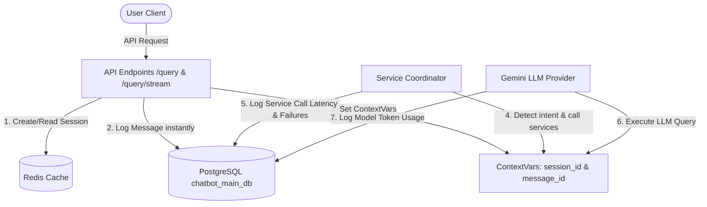

# Main Chatbot Service - Database Integration Summary

This document explains the database integration architecture, the files modified, and the core rationale behind every design decision.

---

## 🏗️ Architectural Overview

The Main Chatbot Service now operates on a hybrid architecture combining **Redis** (for high-speed, volatile conversational context) and **PostgreSQL** (for persistent history, analytics, token usage tracking, and audit logging).

### Database Flow Diagram

---

## 🛠️ Changes Implemented (File by File)

### 1. Database Infrastructure
*   **Modified File**: [`orchestrator/app/infrastructure/database.py`](file:///e:/GDCE-Intern/Local/orchestrator/app/infrastructure/database.py)
    *   **What changed**: Established a thread-safe SQLAlchemy engine and session pool pointing to `chatbot_main_db` on port `5433`. Implemented a self-healing `check_and_create_db()` to create the database programmatically if missing. Added asynchronous context-tracking variables: `session_id_var` and `message_id_var`.
    *   **Why**:
        *   **ContextVars**: Decoupled NLU components (NLU classifier, Input rewriter, response formatter) need to record token usage to Postgres. Instead of passing `session_id` and `message_id` through every function parameter in the AI provider layer, we use request-bound `ContextVars` to automatically resolve active IDs.
        *   **get_db_context()**: Background tasks (like eviction summarization) cannot reuse FastAPI request-scoped dependency sessions (`get_db`) without causing pool corruption. The standalone context manager acquires thread-safe, isolated transaction boundaries.

### 2. SQLAlchemy Relational Schema
*   **Modified File**: [`orchestrator/app/infrastructure/models.py`](file:///e:/GDCE-Intern/Local/orchestrator/app/infrastructure/models.py)
    *   **What changed**: Defined 10 relational tables (`chat_sessions`, `chat_messages`, `session_contexts`, `intent_routes`, `service_calls`, `conversation_summaries`, `chat_feedback`, `chat_attachments`, `failed_requests`, `model_usage_logs`) mapping to PostgreSQL.
    *   **Why**:
        *   **Cascades (`ON DELETE CASCADE`)**: Parent-child relationships (such as session-to-messages or session-to-feedback) are configured with database-level cascading. If a session is deleted, Postgres automatically purges all child records, eliminating dangling pointers.
        *   **Set Null (`ON DELETE SET NULL`)**: Message-level foreign keys (e.g. on `intent_routes`, `chat_feedback`, `chat_attachments`, and `model_usage_logs`) are nullable and set to NULL if a message is deleted. This allows analytical and feedback data to survive individual message pruning.

### 3. Thread-Safe CRUD Persistence Service
*   **Modified File**: [`orchestrator/app/services/db_service.py`](file:///e:/GDCE-Intern/Local/orchestrator/app/services/db_service.py)
    *   **What changed**: Created `ChatbotDBService` wrapper class to run blocking SQL operations in `asyncio.to_thread` executors. Implemented thread-safe upserts using Postgres-specific `ON CONFLICT` clauses.
    *   **Why**:
        *   **Concurrency Protections**: Concurrent requests (e.g. first-time session creation or rapid context updates) can cause duplicate key insert conflicts. Postgres constraints (`uq_session_summary_index` and `session_id` primary key) paired with `ON CONFLICT DO UPDATE` or `ON CONFLICT DO NOTHING` prevent application crashes under heavy load.

### 4. NLU Token Usage Logging
*   **Modified File**: [`orchestrator/app/ai/providers/gemini.py`](file:///e:/GDCE-Intern/Local/orchestrator/app/ai/providers/gemini.py)
    *   **What changed**: Configured the Gemini client wrapper to read token counts (`usage_metadata`) from every successful response (streaming and non-streaming) and automatically record them to `model_usage_logs` via the request's context variables.
    *   **Why**: Centralizes model execution telemetry (prompt, completion, and total tokens) without modifying NLU interface signatures.

### 5. Service Latency & Failure Tracking
*   **Modified File**: [`orchestrator/app/services/coordinator.py`](file:///e:/GDCE-Intern/Local/orchestrator/app/services/coordinator.py)
    *   **What changed**: Wrapped calculator, retrieval, trade query, and definition service calls inside a centralized `_execute_service_call()` helper. Logs microservice response payloads, calculates elapsed call latency (in ms), and captures microservice timeout or runtime exceptions into `failed_requests`.
    *   **Why**: Minimizes duplicate code across downstream routing functions while ensuring latency metrics and exception backtraces are recorded for auditing.

### 6. Live Chat Logging & CRUD Endpoints
*   **Modified File**: [`orchestrator/app/api/endpoints.py`](file:///e:/GDCE-Intern/Local/orchestrator/app/api/endpoints.py)
    *   **What changed**:
        *   In `/query` and `/query/stream`, initialized `session_id_var` and `message_id_var` context variables, and saved live user messages and assistant responses to PostgreSQL.
        *   Added CRUD endpoints for managing sessions (`GET /sessions`, `GET /sessions/{session_id}`, `DELETE /sessions/{session_id}`), feedback submissions (`POST /sessions/{session_id}/feedback`), and attachment associations (`POST /sessions/{session_id}/attachments`).
    *   **Why**:
        *   **Direct-to-Postgres Flow**: Storing message turns in PostgreSQL immediately (instead of only caching in Redis streams and flushing in a background thread) provides **instant consistency**. A user submitting feedback or uploading attachments right after typing a query can immediately reference the message in SQL.
        *   **Cascading Deletes**: `DELETE /sessions/{session_id}` drops the session, triggering the SQL cascade constraint to instantly clean up all associated messages, feedback, and logs.

### 7. Startup Check & Migrations Hook
*   **Modified File**: [`orchestrator/app/main.py`](file:///e:/GDCE-Intern/Local/orchestrator/app/main.py)
    *   **What changed**:
        *   Integrated `check_and_create_db()` and programmatic Alembic migration execution on application startup.
        *   **Disabled Redundant Flusher**: Removed the legacy background task `periodic_transcript_flush` and transcript archive table initialization.
    *   **Why**:
        *   **Startup Migrations**: Running Alembic `upgrade head` programmatically on startup guarantees the Postgres database schema matches the SQLAlchemy entities without requiring manual developer actions.
        *   **Pruned Redundant Flusher**: Since live chat messages are now persisted directly during requests for instant consistency, the background flusher is no longer required and was disabled to prevent double-inserting transcript turns.

---

## 🧪 Verification Metrics

Automated test cases in [test_database.py](file:///e:/GDCE-Intern/Local/orchestrator/tests/test_database.py) verify the integrity of these changes:
*   **`test_session_crud`**: Checks basic insertion, retrieval, and delete of `ChatSession` objects.
*   **`test_concurrency_get_or_create`**: Confirms that 5 threads creating the same session simultaneously do not crash (resolves via `ON CONFLICT DO NOTHING`).
*   **`test_concurrency_context_upsert`**: Confirms that 5 concurrent context updates on the same session succeed (resolves via `ON CONFLICT DO UPDATE`).
*   **`test_concurrency_summary_upsert`**: Validates safe updates of rolling conversation summaries on the same session and message index boundary (resolves via `ON CONFLICT ON CONSTRAINT uq_session_summary_index`).
*   **`test_nullability_and_cascade`**: Asserts that deleting a message sets foreign keys to NULL (`ON DELETE SET NULL`) to keep analytics intact, and deleting a session cascadingly purges all dependent data (`ON DELETE CASCADE`).
