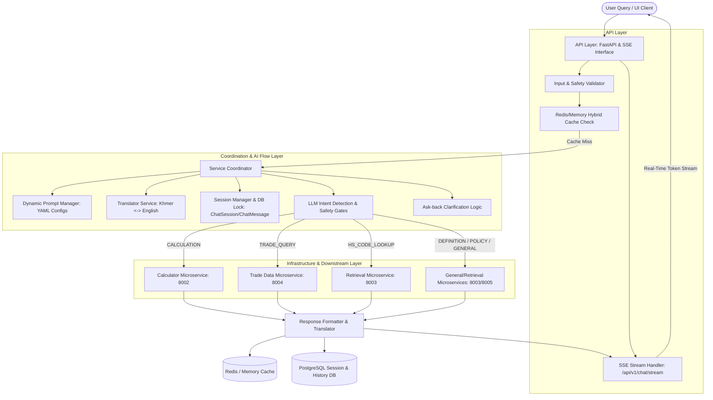

# GDCE Chatbot Orchestrator Architecture

The **Orchestrator Service (v2)** is a FastAPI-based central routing gateway for the GDCE Chatbot system. It manages user input validation, intent classification, multi-turn session memory, context-aware query rewriting, bilingual translation, downstream service invocation, SSE response streaming, response aggregation, and Redis hybrid cache management.

---

## 🏗️ Architectural Layers

The service is structured into modular layers to segregate HTTP handling, business logic, AI prompt management, and backend infrastructure:



### 1. API Layer (`app/api/`)
This layer handles external HTTP interfaces, request validation, SSE streaming, and caching.
* **Endpoints (`api/endpoints.py`):** Exposes `/api/v1/chat`, real-time Server-Sent Events `/api/v1/chat/stream`, `/api/v1/session/{session_id}`, plus health & diagnostic routes (`/health`, `/ready`, `/metrics`, `/admin/cache-stats`).
* **Real-time SSE Streaming:** Uses FastAPI `StreamingResponse(text/event-stream)` to deliver token-by-token response deltas (`type: content`), citations, metadata (`type: metadata`), and stream termination signals (`type: done`) directly to the frontend UI with sub-300ms Time-To-First-Token.
* **First-line Security & Middleware:** Applies `RequestLoggingMiddleware` (injecting `X-Request-ID` correlation headers) and runs `input_validator` for prompt injection, SQL injection, and scope verification.
* **Pre-Coordinator Cache:** Checks the `CacheService` (Hybrid Memory + Redis). On a cache hit for cacheable intents (`calculation`, `hs_code_lookup`, `definition`, `policy`, `trade_query`), it bypasses downstream microservices and returns the cached response instantly.

### 2. Coordination & Flow Layer (`app/services/` & `prompts/`)
Executes business logic, manages prompt templates dynamically, and maintains dialogue state.
* **Dynamic Prompt Manager (`prompts/dynamic_prompt_manager.py`):** Replaces hardcoded strings with dynamic YAML-based prompt templates loaded from `prompts/config/`, `prompts/core_tasks/`, `prompts/formatting/`, and `prompts/safety/`.
* **Translation Layer (`app/services/translator.py`):** Provides bidirectional translation (Khmer <-> English) for incoming user queries and outgoing formatted answers to support seamless bilingual query processing.
* **Session Management & DB Persistence (`app/infrastructure/database.py`):** Persists session history (`ChatSession`, `ChatMessage`, `ChatFeedback`, `ChatAttachment`) into PostgreSQL via `ChatbotDBService`. Implements distributed/per-session locks (`_session_locks`) to handle concurrent user requests safely.
* **Context-Aware Query Rewriter (`RewriterService`):** Resolves pronouns, missing entities, and turn-to-turn context by evaluating previous dialogue state (`last_intent`, `last_entity`, `last_normalized_query`).
* **Intent Detection & Safety Gates (`WorkflowExecutor`):** Uses an LLM first layer to detect user intent (`hs_code_lookup`, `calculation`, `trade_query`, `policy`, `definition`), backed by a deterministic keyword ladder fallback.
* **Ask-Back Clarification Logic:** Triggers structured ask-back prompts (`MAX_PRODUCT_ASK_BACK_RETRIES = 2`) when product specifications (e.g. engine CC, vehicle type) are missing, forcing clarification before routing.

### 3. Infrastructure & Microservices Layer (`app/infrastructure/`)
Manages downstream HTTP microservice clients, circuit breakers, and database connections.
* **Microservice Clients:** Communicates via HTTP REST endpoints with:
  - **Retrieval Microservice (Port 8003):** Vector lookup in Qdrant, HS code candidate ranking, and document chunk retrieval.
  - **Calculator Microservice (Port 8002):** Customs duty, excise tax, VAT calculations, and exchange rate processing.
  - **Trade Data Microservice (Port 8004):** Customs import/export volume statistics.
  - **General Microservice (Port 8005):** GDCE regulations, FAQ knowledge, and general procedures.
* **Redis & Memory Hybrid Cache (`app/infrastructure/cache_service.py`):** Supports `CacheLevel.HYBRID` (In-Memory + Redis) with intent-specific TTLs (24h for calculations/trade data, 48h for definitions/policies).
* **Resilience Mechanisms:** 
  - **Circuit Breaker:** Prevents cascading failures by monitoring error rates (`CLOSED`, `OPEN`, `HALF_OPEN`).
  - **Exponential Backoff & Retries:** Automatically handles transient network glitches and timeouts.
  - **Prometheus Telemetry (`/metrics`):** Exposes query counters, duration histograms, cache hit rates, and error metrics.

---

## 🔄 Query Processing Lifecycle

```
[User Request] ──► Input Security Validation ──► Redis/Memory Cache Check
                         │                                    │
                         └──► Session Retrieval & DB Lock ───┘
                                   │
                                   ▼
                         [Translation Layer (Khmer <-> EN)]
                                   │
                                   ▼
                         [Intent Detection & Safety Gates]
                         ├── CALCULATION    ──► Calculator Microservice (8002)
                         ├── TRADE_QUERY    ──► Trade Data Microservice (8004)
                         ├── HS_CODE_LOOKUP ──► Retrieval Microservice (8003)
                         └── DEFINITION     ──► General/Retrieval Microservices (8003/8005)
                                   │
                                   ▼
                         [Formatter & Dynamic Prompt Manager]
                                   │
                    ┌──────────────┴──────────────┐
                    ▼                             ▼
          [SSE Token Stream]             [PostgreSQL & Redis Save]
       (/api/v1/chat/stream)                      │
                    │                             ▼
                    └─────────────────────► [Frontend UI Render]
```

### Step 1: Request Interception & Correlation
`RequestLoggingMiddleware` assigns a unique `X-Request-ID` to trace the call across microservices and log structured execution metrics.

### Step 2: Input & Security Validation
`InputValidator` checks the input string for prompt injection attacks, SQL injections, or out-of-scope topics.

### Step 3: Cache Pre-Check
`CacheService` checks for an existing response in Redis/Memory. On a hit, it returns immediately and updates the session context.

### Step 4: Session Recovery & Translation
Loads dialogue history from PostgreSQL (`ChatSession`/`ChatMessage`). If the query is in Khmer, `TranslatorService` prepares English translations for downstream semantic vector searches.

### Step 5: Intent Classification & Rewriting
`WorkflowExecutor` classifies the query intent using dynamic prompts (`prompts/core_tasks/`). `RewriterService` reformulates follow-up queries using prior dialogue entities.

### Step 6: Clarification Gate (Ask-Back)
If required entity attributes are missing (e.g. calculation parameters), the orchestrator returns an ask-back prompt, holding state in the session store.

### Step 7: Microservice Routing
The coordinator dispatches the request to the appropriate microservice (Retrieval 8003, Calculator 8002, Trade Data 8004, or General 8005) via resilient HTTP clients protected by circuit breakers.

### Step 8: Dynamic Formatting & Response Translation
Downstream outputs are formatted using `OrchestratorFormatterService` guided by `prompts/formatting/` YAML configs. If requested in Khmer, `TranslatorService` translates the final answer back to Khmer.

### Step 9: SSE Token Streaming & Persistence
If called via `/api/v1/chat/stream`, the response is streamed token-by-token to the UI via Server-Sent Events (`StreamingResponse`). Concurrently, the final message is saved into PostgreSQL database history and cached in Redis with an intent TTL.

