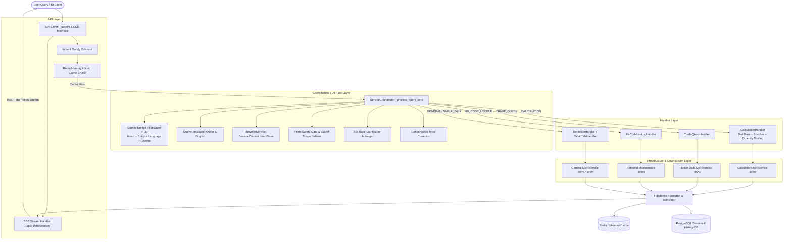

# GDCE Chatbot Orchestrator Architecture

The **Orchestrator Service** is a FastAPI-based central routing gateway for the GDCE Chatbot system. It manages user input validation, intent classification, multi-turn session memory, context-aware query rewriting, bilingual translation, downstream service invocation, SSE response streaming, response aggregation, and Redis hybrid cache management.

---

## 🏗️ Architectural Layers

The service is structured into modular layers to segregate HTTP handling, business logic, AI prompt management, and backend infrastructure:



---

### 1. API Layer (`app/api/`)

Handles external HTTP interfaces, request validation, SSE streaming, and cache pre-checks.

- **Endpoints (`api/endpoints.py`):** Exposes `/api/v1/chat` (sync), `/api/v1/chat/stream` (SSE), `/api/v1/session/{session_id}`, and diagnostic routes (`/health`, `/ready`, `/metrics`, `/admin/cache-stats`).
- **Real-time SSE Streaming:** Uses FastAPI `StreamingResponse(text/event-stream)` to deliver token-by-token response deltas (`type: content`), citations, metadata (`type: metadata`), and stream termination signals (`type: done`) directly to the UI with sub-300ms Time-To-First-Token.
- **Security & Middleware:** `RequestLoggingMiddleware` injects `X-Request-ID` correlation headers. `InputValidator` screens for prompt injection, SQL injection, and scope violations before any session is loaded.
- **Pre-Coordinator Cache:** `CacheService` (Hybrid Memory + Redis) is checked before the coordinator is invoked. On a cache hit for cacheable intents (`calculation`, `hs_code_lookup`, `definition`, `policy`, `trade_query`) the cached response is returned immediately, bypassing all downstream microservices.

---

### 2. Coordination & AI Flow Layer (`app/services/`)

Executes the 13-step processing pipeline, manages the Gemini-based first-layer NLU, and maintains multi-turn dialogue state.

- **Gemini Unified First-Layer NLU (`first_layer_service`):** A single Gemini call (via `gemini_unified_first_layer` prompt) returns structured JSON: intent, entity, entity confidence, language, ambiguity flag, `rewritten_query`, `service_query`, `query_nature`, and an optional `suggested_clarification_prompt`. This replaces what were previously multiple separate LLM calls (intent detector + rewriter + language detector).
- **Conservative Typo Corrector (`_normalize_query_typos`):** Applies gazetteer-based correction only when the corrected query maps to the same deterministic intent as the original, preventing silent entity corruption.
- **Input Rewriter (`RewriterService`):** For non-merge paths, calls the LLM rewriter to resolve pronouns, relative prefixes (`"and for..."`), and implied context using prior session state. Skipped entirely when intent was locked from a clarification merge (to avoid wasting a full LLM round-trip on a clean query).
- **Rewrite Validator (`_is_rewrite_valid`):** After the LLM rewriter runs, a structural sanity check validates the output. If it detects hallucinated content or corruption, it reverts to the original query.
- **Intent Safety Gate (`_apply_intent_safety_gate`):** Post-classification guard that can override LLM intent decisions — e.g. downgrading `HS_CODE_LOOKUP` → `GENERAL` when `query_nature == "procedural"`, or blocking unsafe intent transitions.
- **Dual Out-of-Scope Gates:**
  1. *Early validator gate*: fires before intent classification if `ValidatorService` determines the query is out of scope.
  2. *Post-intent gate*: fires after classification if intent is `SMALL_TALK` but `_is_genuine_conversational_small_talk` returns `False`. Both gates call the same `_build_out_of_scope_response` helper and return `intent: "out_of_scope"`.
- **Ask-Back Clarification Logic (`ClarificationManager`):** Two independent state machines — intent ambiguity ask-back (`pending_clarification`) and product-spec clarification (`product_clarification_needed`) — each with configurable retry caps (`MAX_ASK_BACK_RETRIES = 2`). The `CALCULATION` intent is explicitly excluded from the generic ask-back gate; its slot-collection gate in `CalculationHandler` handles ambiguity more precisely.
- **Topic-Switch Detection:** On Turn 2+, compares NLU entity tokens against the saved `last_entity` in session. On a non-overlapping mismatch, clears all context slots to prevent stale data pollution before rewriting.
- **Session Manager (`RewriterService`):** Loads/creates `SessionContext` early in the pipeline (Step 2) and flushes updates to Redis + disk + PostgreSQL at Step 13.

---

### 3. Handler Layer (`app/services/handlers/`)

Specialized logic per intent, invoked by `_route_query` after microservice selection:

- **`CalculationHandler` (`handlers/calculation.py`):** Enriches the service query from session context (CIF, HS code, origin, quantity); runs a sequential slot-collection gate (product → HS code → CIF, one missing slot asked per turn via `calc_slot_collection`); checks value plausibility and source trust; constructs a canonical calculator query string with quantity scaling (without `"each"` to prevent double-multiplication); and calls the Calculator microservice. Also handles HS clarification resolution when Retrieval returned multiple HS candidates.
- **`HsCodeLookupHandler` (`handlers/hs_lookup.py`):** Calls the Retrieval microservice for vector-based HS code search. Handles `is_generic=True` disambiguation by setting `product_clarification_needed` on the session for follow-up spec collection.
- **`TradeQueryHandler` (`handlers/trade_query.py`):** Calls the Trade Data microservice with parsed year/month/country parameters.
- **`DefinitionHandler` (`handlers/definition.py`):** Routes to Retrieval or General microservice for policy/FAQ/regulatory queries.
- **`SmallTalkHandler` (`handlers/small_talk.py`):** Returns a friendly LLM-generated or rule-based conversational reply.

---

### 4. Infrastructure & Microservices Layer (`app/infrastructure/`)

Manages downstream HTTP microservice clients, circuit breakers, and database connections.

- **Microservice Clients (`clients.py`):** HTTP REST clients for Calculator (:8002), Retrieval (:8003), Trade Data (:8004), and General (:8005). `CalculatorServiceClient` contains `_parse_question_for_calculation` — the canonical string parser used for slot extraction, quantity scaling, and unit-price detection (`looks_like_unit_price`).
- **Redis & Memory Hybrid Cache (`cache_service.py`):** Supports `CacheLevel.HYBRID` with intent-specific TTLs (24h for calculations/trade data, 48h for definitions/policies).
- **Resilience:** Circuit breaker (`CLOSED`/`OPEN`/`HALF_OPEN`), exponential backoff retries, and Prometheus telemetry (`/metrics`).
- **Database (`database.py`):** PostgreSQL persistence via `ChatbotDBService` for `ChatSession`, `ChatMessage`, `ChatFeedback`, `ChatAttachment`. Distributed per-session locks (`_session_locks`) handle concurrent request safety.

---

## 🔄 13-Step Query Processing Pipeline

The actual execution order inside `ServiceCoordinator._process_query_core`:

```
[User Request] → process_query()
    │  Khmer detected → translate to English first
    ▼
Step 1 : Initialize WorkflowContext (request_id, metadata scaffold, detected_language)
    │
    ▼
Step 2 : Light normalize query → detect currency early → load SessionContext (RewriterService)
         → check pure-language-request short-circuit (translate last bot response, return early)
         → apply conservative typo correction (_normalize_query_typos)
         → check product-spec clarification merge (_try_merge_product_spec)
    │
    ▼
Step 3 : Small-talk fast-path flag check (from previously cached NLU result)
    │
    ▼
Step 4 : Cleanup query (strip excessive punctuation/whitespace) → context.cleaned_input
    │
    ▼
Step 7 : Clarification resolution (if session.is_awaiting_clarification()):
         → small-talk exit check
         → topic-switch detection with confidence bands (exit / nested ask-back / stay)
         → escape-hatch detection (resolve to macro trade defaults)
         → resolve intent from user reply → _merge_pending_with_clarification()
         → lock intent + skip_intent_detection = True
    │
    ▼
Step 5 : Input validation & safety scope check (ValidatorService.validate_input_full_async)
         → hard failure on injection/format violations
         → early out-of-scope gate → _build_out_of_scope_response() (if not in_scope)
    │
    ▼
Step 8 : Intent Classification
         → Reuse cached NLU intent from first_layer_service (if query key matches)
         → OR reuse LLM validator intent (if reason starts with "llm_validated:")
         → OR run workflow_executor.detect_intent_with_confidence()
         → Multilingual language resolution (pin / auto / explicit / Khmer directive)
         → Apply Intent Safety Gate (_apply_intent_safety_gate)
         → Post-intent out-of-scope gate (SMALL_TALK that isn't genuine conversational)
    │
    ▼
Step 10: Ask-Back / Ambiguity Gate (if not already resolved, and not CALCULATION):
         TRADE_QUERY → 7-row decision matrix (confidence × NLU ambiguity × regex vague)
         Other intents → trigger if _intent_confidence < 0.60 or turn-2 non-self-sufficient
         On trigger → save session, return ask-back response (halts pipeline)
    │
    ▼
Step 9 : Core Intent Filter:
         Non-core intents (UNCLASSIFIED etc.) → fallback to SMALL_TALK LLM reply
    │
    ▼
Step 11: Context-Aware Input Rewriting
         → Topic-switch: clear session slots if entity token overlap = 0
         → If intent locked post-merge: skip LLM rewrite (use merged query as-is)
         → Otherwise: RewriterService.rewrite_input() → _is_rewrite_valid() → accept/revert
    │
    ▼
Step 12: Microservice Selection & Routing
         → _select_service_query: use accepted rewrite or original query
         → Postponed safety gate re-applied on final service query
         → _route_query() dispatches to handler (CalculationHandler, HsCodeLookupHandler, ...)
         [Handler runs: slot-gate → enrich → microservice call → set context result]
    │
    ▼
Step 13: Session State Update
         → tracking_query = accepted rewrite OR cleaned original
         → _build_session_update_payload: last_intent, last_entity, last_normalized_query
         → rewriter_service.update_session_context()
         → add_turn (sync mode); clarification turns always saved synchronously
         → save_intent_route + save_session_context to PostgreSQL
    │
    ▼
      Build response dict
      stream=True  → return raw context dict (_stream=True) for SSE endpoint
      stream=False → format, translate to Khmer if needed, return final JSON
```

---

### Streaming vs. Synchronous Response Paths

| Mode | Behavior |
| :--- | :--- |
| **Synchronous** (`/api/v1/chat`) | Coordinator runs the formatter service, translates to Khmer if `target_language=km`, batch-translates suggestions and clarifications, returns complete JSON. `add_turn` is called before returning. |
| **Streaming** (`/api/v1/chat/stream`) | Coordinator returns a raw `WorkflowContext` dict with `_stream=True`. The SSE endpoint owns the final Gemini generation step and streams tokens in real time. `add_turn` is called by the endpoint after the stream completes. Clarification turns (which return no streamed tokens) are saved synchronously by the coordinator before the endpoint yields. |

---

## 🔑 Key Design Decisions

| Decision | Rationale |
| :--- | :--- |
| **Single Gemini first-layer call** | Replaces separate intent + entity + language + rewrite LLM calls — cuts LLM latency from 3–4 serial calls to 1 per turn. |
| **Rewrite skipped post-clarification-merge** | The merge step already produces a clean, normalized query; an LLM rewrite wastes ~1–2 s for zero improvement. |
| **CALCULATION excluded from generic ask-back gate** | Calculation slot collection (product → HS code → CIF, one slot per turn via `calc_slot_collection`) handles ambiguity more precisely than the generic confidence-threshold gate. |
| **`last_normalized_query` always prepended in history scan** | Ensures CIF/origin/currency can be inherited even when the current turn explicitly switches HS codes; only the HS backfill line carries the `has_explicit_hs_in_query` guard — CIF and origin inheritance are unaffected. |
| **Net mass regex requires explicit `net mass`/`net weight` prefix** | The optional-prefix form `(?:net\s+mass\s+)?(\d+)\s*kg` false-positives on DV/DQ values, HS code digit sequences, and other bare numbers present in enriched query strings. |
| **Rewrite validator reverts on structural corruption** | Prevents rewriter hallucinations (wrong entity names, injected numbers) from silently corrupting downstream slot extraction. |
