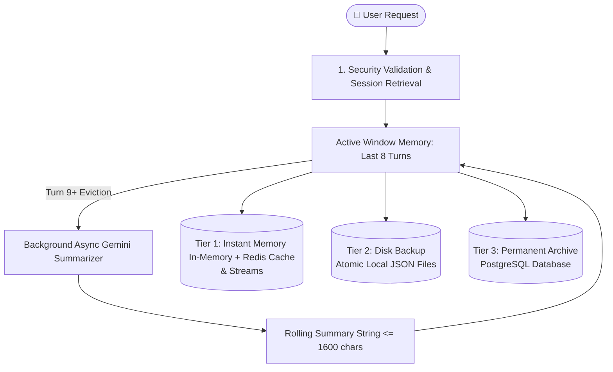
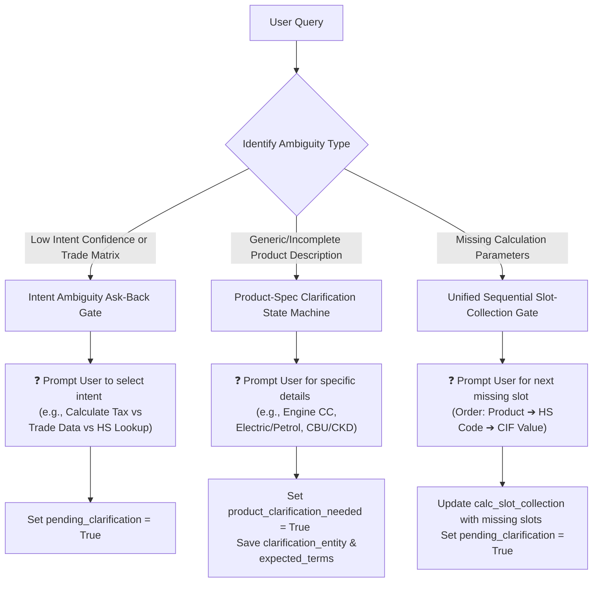

# Session Context & Conversation Management Guide

This document provides a comprehensive breakdown of **Session Context**, **Conversation Memory**, **Multi-Tier Storage Architecture**, **Gating Rules**, and **End-to-End Query Processing** within the **GDCE Chatbot Orchestrator Service**.

---

## 1. High-Level User Flow & Pipeline Journey

The diagram below shows the 4-phase journey of a user message through the 13-step Orchestrator system:

```mermaid
flowchart TD
    %% Custom Node Styling
    classDef intake fill:#3498DB,stroke:#1F618D,stroke-width:2px,color:#fff;
    classDef ai fill:#8E44AD,stroke:#5B2C6F,stroke-width:2px,color:#fff;
    classDef gate fill:#F39C12,stroke:#B9770E,stroke-width:2px,color:#fff;
    classDef service fill:#2ECC71,stroke:#1E8449,stroke-width:2px,color:#fff;
    classDef memory fill:#16A085,stroke:#117A65,stroke-width:2px,color:#fff;

    subgraph PHASE1 ["1️⃣ INTAKE & PREPARATION (Steps 1-4)"]
        User([👤 User Request]) --> Security{Passes Safety/Scope Check?}:::intake
        Security -- No --> Blocked[🛑 Security/Out-of-Scope Refusal]:::intake
        Security -- Yes --> LoadSession[📖 Load Session Context & Lock Session]:::intake
        LoadSession --> SpecMerge{Awaiting Spec?}:::intake
        SpecMerge -- Yes --> MergeSpec[🧩 Try Product Spec Merge]:::intake
        SpecMerge -- No --> CleanInput[🧹 Cleanup Query & Typo Correction]:::intake
        MergeSpec --> CleanInput
    end

    subgraph PHASE2 ["2️⃣ CLARIFICATION RESOLUTION (Step 7)"]
        CleanInput --> ClarPending{Awaiting Intent Clarification?}:::gate
        ClarPending -- Yes --> ResolveClar[🔄 Resolve Intent & Merge Queries\n• Skip Rewriter Post-Merge]:::gate
        ClarPending -- No --> Classify[🤖 Classify Intent & Language]:::ai
        ResolveClar --> Classify
    end

    subgraph PHASE3 ["3️⃣ ROUTING & GATING (Steps 5, 8-12)"]
        Classify --> AskBack{Ambiguous Intent?}:::gate
        AskBack -- Yes (conf < 0.60 or Trade Matrix) --> IntentAskBack[❓ Ask-Back Gate: Query User]:::gate
        AskBack -- No --> TopicSwitch{Topic/Entity Switch?}:::ai
        TopicSwitch -- Yes --> ClearSlots[🧹 Clear Context Slots]:::ai
        TopicSwitch -- No --> Rewrite[🤖 Context-Aware Rewriter]:::ai
        ClearSlots --> Rewrite
        Rewrite --> Route[🎯 Route to Handler & Microservice]:::service
        Route --> Calc[🧮 Calculator Service\n• Slot Gate: Product ➔ HS ➔ CIF]:::service
        Route --> Trade[📊 Trade Data Service]:::service
        Route --> Retrieval[🔍 Retrieval Service]:::service
        Route --> General[📄 General Policy Service]:::service
    end

    subgraph PHASE4 ["4️⃣ RESPONSE & MEMORY UPDATE (Step 13)"]
        Calc & Trade & Retrieval & General & IntentAskBack & Blocked --> Format[✨ Format Markdown Answer & Translate back to Khmer]:::memory
        Format --> Stream[🚀 SSE Token Stream or Sync JSON]:::memory
        Stream --> MemoryUpdate[💾 Update Memory Tiers\n• Active Window (Last 8 turns)\n• Rolling Summary (Evicted turn 9+)\n• Flush to Redis, Disk & Database]:::memory
    end
```

---

## 2. System Architecture & Memory Model

To maintain sub-300ms Time-To-First-Token and minimize LLM token costs, the Orchestrator employs a **two-tier memory model** combined with a **three-tier storage architecture**.



### Memory Tiers & Lifecycle

* **Active Window Memory (Last 8 Turns)**: The `SessionContext` maintains an active window array of up to 8 conversation turns (`max_turns = 8`). This keeps prompt payloads compact and prevents token bloat.
* **Eviction & Async Rolling Summary (Turn 9+)**: When conversation history exceeds 8 turns, the oldest turns are evicted from the active array. The `SessionManager` triggers an asynchronous background task (`async_summarize_evicted_turns`) using Gemini (`summarize_evicted_turns` prompt template) to update a running **Rolling Summary** text string (capped at 1,600 characters). If Gemini is unavailable, a deterministic fallback (`fallback_summary`) cleanly slices history on turn boundaries (`U:... B:...`).
* **Context Slots & Extended State**: Tracks domain parameters across turns:
  * `product_category`, `product_category_km`, `hs_code`, `cif_value`
  * `origin_country`, `destination_country`, `currency`, `commercial_description`
  * `year`, `month`, `trade_agreement`
  * `last_intent`, `last_entity`, `last_raw_query`, `last_normalized_query`
  * `calc_slot_collection` (sequential slot-collection metadata)

---

## 3. Three-Tier Storage Architecture

To ensure zero memory loss across server restarts, high throughput, and long-term analytics, state is saved across three tiers:

| Tier | Storage Layer | Mechanism & Implementation | Primary Purpose |
| :--- | :--- | :--- | :--- |
| **Tier 1** | **Instant Active Memory** | In-Memory `SessionContext` dict + Redis Cache (`session:{id}:context`, 1h TTL) + Redis Streams (`session:{id}:transcript` via `XADD`). | Ultra-fast context lookup (< 1ms) and real-time event streaming. |
| **Tier 2** | **Local Disk Backup** | Atomic JSON file persistence under `app/session_store/{session_id}.json`. Writes to `.tmp` file and atomically replaces. | Crash resilience and offline operation without external database dependencies. |
| **Tier 3** | **Permanent DB Archive** | PostgreSQL database persistence (`ChatSession`, `ChatMessage`, `transcript_archive`) via `ChatbotDBService` and background `session_flusher.py`. | Permanent storage, historical auditing, user history queries, and analytics. |

---

## 4. Clarification & State Machine Architecture

The system features three independent state machines to handle conversation ambiguity and missing slots:



### A. Intent Ambiguity Ask-Back Gate
* **Trigger**: Low intent classification confidence ($< 0.60$), multiple conflicting intents, or matching a vague query in the **7-row Trade Data decision matrix** (confidence vs. NLU ambiguity vs. regex vague).
* **Behavior**: Halts downstream microservice routing immediately and prompts the user to clarify their request intention.
* **Tracked State**: `pending_clarification: bool`, `clarification_intents: List[str]`, `pending_rewritten_query: Optional[str]`, `ask_back_count: int`.
* **Resolution**: When a user replies, it maps their choice back to the locked intent, merges the original pending query with the clarification response, locks the intent (`skip_intent_detection = True`), and proceeds.

> [!NOTE]
> **Rewrite Bypass Post-Merge**: Once a query has been resolved and merged through the clarification manager, the rewriter is skipped entirely. A clean, normalized query was already constructed during the merge, and running another LLM rewrite round-trip would waste 1–2s of latency.

### B. Product-Spec Clarification State Machine
* **Trigger**: Required product technical specifications (e.g., engine CC, fuel type, vehicle assembly mode) are missing for accurate tariff lookup.
* **Retry Limit**: Capped at `MAX_PRODUCT_ASK_BACK_RETRIES = 2`.
* **Tracked State**: `product_clarification_needed: bool`, `clarification_entity: Optional[str]`, `clarification_last_query: Optional[str]`, `product_ask_back_count: int`, `clarification_expected_terms: List[str]`.
* **Spec Merging Logic**: Evaluates user input against `clarification_expected_terms` or category discriminators (`_SPEC_DISCRIMINATORS` for vehicle, food, textile). If valid detail is provided, it merges short answers with saved product entities:
  $$\text{"2000cc"} + \text{"Toyota Camry"} \longrightarrow \text{"2000cc Toyota Camry"}$$

### C. Unified Sequential Slot-Collection Gate (Calculation)
* **Trigger**: Invoked when intent is `CALCULATION` but mandatory parameters are missing.
* **Slot Order**: **Product Category/Description** $\rightarrow$ **HS Code** $\rightarrow$ **CIF Value**.
* **Behavior**: Checks the enriched query and session context. If any slot is missing, it asks for exactly **one** parameter per turn, saving the rest in `calc_slot_collection` on the session. It halts calculation and returns `status = CLARIFICATION_REQUIRED`. Once all slots are filled, the buffer is cleared and routed to the Calculator service.
* **Valuation Plausibility**: For CIF values, checks float parsing and applies currency-aware rules (e.g., KHR has no decimal subunit in practice).

---

## 5. Topic-Switch & Context Pollution Guards

To prevent stale state (e.g., Turn 1's product info) from corrupting Turn 2's query when the user explicitly switches topics, the orchestrator implements active context validation:

1. **Entity Token-Overlap Check**: Compares the incoming NLU entity tokens against the saved `last_entity` in session. If there is a complete mismatch (zero token overlap) and the user has not input a negation/correction keyword (e.g., `"actually"`, `"no"`, `"sorry"`), the system registers a **Topic Switch**.
2. **Clear Context Slots**: Immediately resets short-term memory slots (`product_category`, `hs_code`, `cif_value`, `origin_country`, etc.) before passing the query to the rewriter or downstream service. This prevents the rewriter from gluing the old product's details to the new one.

---

## 6. Step-by-Step Scenario Analysis

### Scenario A: Lexical Noise (Fast Local Track)
* **User Question**: *"Um, actually, can you please tell me what is the import tax on rice?"*
* **Analysis**: Filler words (*"um"*, *"actually"*, *"can you please"*) constitute lexical noise.
* **Action**: Stripped instantly using regex in local code (**0ms additional latency**).
* **Rewritten Result**: `"what is the import tax on rice?"` $\rightarrow$ Routed to Calculator Microservice (Port 8002).

### Scenario B: Semantic Narrative Noise (Clean-up Track)
* **User Question**: *"I was talking to my business partner yesterday, and he told me that we want to import laptops, what documents do we need?"*
* **Analysis**: Narrative story markers (*"talking to my business partner"*, *"he told me"*).
* **Action**: Handled by `RewriterService` using Gemini context prompt to extract core intent.
* **Rewritten Result**: `"what documents do we need to import laptops?"` $\rightarrow$ Routed to General Policy Microservice (Port 8005).

### Scenario C: Contextual Follow-Up Query (Memory Track)
* **Turn 1 User**: *"What is the import duty for rice?"* (Calculator intent; `product_category: "rice"` saved in slots).
* **Turn 2 User**: *"And for laptops?"*
* **Analysis**: Starts with relative prefix (*"And for"*), missing core intent verb.
* **Action**: `RewriterService` retrieves `last_intent` (`CALCULATION`) and session context to rewrite query.
* **Rewritten Result**: `"What is the import duty for laptops?"` $\rightarrow$ Routed to Calculator Microservice (Port 8002).

### Scenario D: Mid-Conversation Spec Clarification Merge
* **Turn 1 User**: *"Import tax for Toyota Camry"*
* **Bot Response**: *"Could you please specify the engine size (e.g. 2000cc, 2500cc, hybrid)?"* (`product_clarification_needed = True`, `clarification_entity = "Toyota Camry"`).
* **Turn 2 User**: *"2000cc"*
* **Analysis**: Input matches spec discriminator `2000cc`.
* **Action**: Merges answer with saved entity $\rightarrow$ `"2000cc Toyota Camry"`. Resets spec clarification state and routes query.
* **Result**: Tax calculation completed for a 2000cc Toyota Camry.

### Scenario E: Low Intent Confidence (Ask-Back Guard Track)
* **User Question**: *"import thing"*
* **Analysis**: Intent confidence score $< 0.60$.
* **Action**: Triggers Intent Ask-Back Gate (`pending_clarification = True`). Halts routing immediately.
* **Bot Response**: *"I'm not sure which service you need. Would you like to calculate duty fees, look up an HS tariff code, or view import regulations?"*

---

## 7. Summary of Gating & Trigger Rules

| Gate / Module | Trigger Criteria | Action Taken | Latency Impact |
| :--- | :--- | :--- | :--- |
| **Lexical Noise Cleaner** | Contains filler words (*"um"*, *"actually"*, *"please"*). | Regex string stripping in local code. | **0ms** (Instant local regex) |
| **Early Validator Gate** | `ValidatorService` flags SQLi, prompt injection, or out-of-scope query. | Returns out-of-scope refusal early; response is never cached. | **~5ms** (Regex & keyword check) |
| **Topic-Switch Detector** | Mismatch (zero overlap) in NLU entity tokens vs. saved `last_entity`. | Wipes short-term session slots (`hs_code`, `cif_value`, etc.) to avoid pollution. | **0ms** (Token match logic) |
| **Clarification Resolver** | Session context has `pending_clarification = True` on incoming turn. | Resolves intent, merges query, sets `skip_intent_detection=True`. | **~10ms** (Local merging) |
| **Smart Query Rewriter** | Relative prefix, pronouns, or short query ($\le 3$ words). Skipped if intent is locked post-merge. | Uses `RewriterService` to rewrite query; runs `_is_rewrite_valid` guard. | **~100-200ms** (LLM rewrite) |
| **Intent Ask-Back Gate** | Intent confidence score $< 0.60$ OR Trade Data decision matrix. | Stops routing pipeline; prompts user to select target intent. | **0ms** (Halts execution early) |
| **Product-Spec Clarification** | Missing required product parameters (engine CC, fuel type, assembly mode). | Asks clarifying spec question; saves entity and expected terms (`MAX_RETRIES = 2`). | **0ms** (Pauses until next user turn) |
| **Calculation Slot Gate** | Missing product, HS code, or CIF value for a calculation request. | Asks for exactly **one** missing slot per turn; tracks in `calc_slot_collection`. | **0ms** (Halts execution early) |
| **Async Rolling Summarizer** | Active turns array exceeds `max_turns = 8`. | Evicts oldest turns; generates Gemini background summary (max 1600 chars); updates DB. | **0ms** (Runs in background event loop) |
| **Hybrid Response Cache** | Matching query & parameters in Redis/Memory Cache. | Returns pre-computed response deltas instantly; bypasses downstream microservices. | **< 5ms** (Instant cache hit) |


