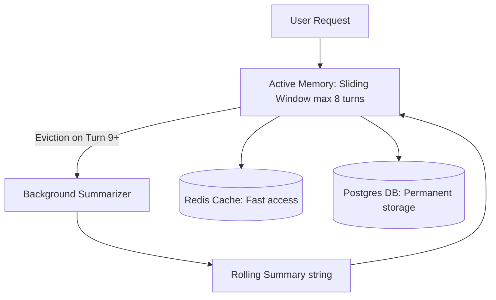
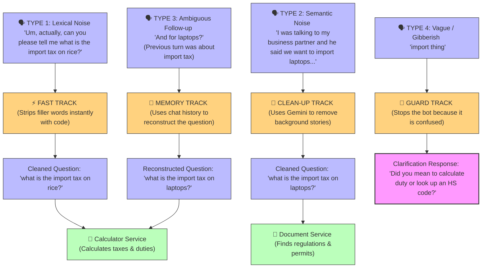

# Session Context & Conversation Management Guide

This guide explains in simple terms how the Cambodia Customs and Trade chatbot manages conversation memory, stores chat data, cleans up user inputs, and routes different types of queries.

---

## 1. Core Architecture: The Memory System
To keep response times fast and LLM costs low, the chatbot uses a **two-tier memory architecture**:

* **Active Memory (Max 8 Turns)**: The chatbot only reads and tracks the last 8 turns of conversation in active memory. This prevents request payloads from growing too large.
* **Rolling Summary (Turns 9+)**: When the conversation exceeds 8 turns, the oldest turns are evicted and compiled by Gemini in the background into a running **Rolling Summary** text string. This summary is injected into future requests so the bot never forgets the context.
* **Context Slots**: Special fields tracked in the session state (e.g. `product_category`, `import_export_mode`, `currency`) that help resolve ambiguous queries.

---

## 2. Query Journey Flowchart
Here is how the chatbot classifies and cleans different types of questions:

---

## 3. Step-by-Step Scenario Analysis

### ⚡ Scenario A: Lexical Noise (Fast Track)
* **User Question**: *"Um, actually, can you please tell me what is the import tax on rice?"*
* **Ambiguity Gating**: Evaluated as **Not Ambiguous** (it has intent indicators, a product category, and is a complete sentence).
* **Noise Gating**: Matches lexical patterns (*"um"*, *"actually"*, *"could you please"*).
* **Action**: Stripped locally using fast regex passes inside `pipeline.py` (takes **0ms additional latency**).
* **Result Sent Downstream**: `"what is the import tax on rice?"` (routed to the Calculator).

### 🤖 Scenario B: Semantic Narrative Noise (Clean-up Track)
* **User Question**: *"I was talking to my business partner yesterday, and he told me that we want to import laptops, what documents do we need?"*
* **Ambiguity Gating**: Evaluated as **Not Ambiguous** (all query slots are complete).
* **Noise Gating**: Matches narrative patterns (*"business partner"*, *"he told me"*).
* **Action**: Triggered semantic noise. Falls through to the rewriter which returns the Gemini pre-warmed cache version (takes **0ms additional latency** in production).
* **Result Sent Downstream**: `"what documents do we need to import laptops?"` (routed to the General policy RAG).

### 🧠 Scenario C: Ambiguous Follow-Up (Memory Track)
* **User Turn 1**: *"What is the import duty for rice?"* (Calculator intent classified; `product_category: "rice"` saved in session slots).
* **User Turn 2**: *"And for laptops?"*
* **Ambiguity Gating**: Evaluated as **Ambiguous** (it starts with follow-up prefix *"And for"*, and is too short to be self-sufficient).
* **Action**: Sent to the LLM query rewriter, which uses the previous turn and saved slots to rebuild the query.
* **Result Sent Downstream**: `"What is the import duty for laptops?"` (routed to the Calculator).

### 🛑 Scenario D: Clarification Ask-Back (Guard Track)
* **User Question**: *"import thing"* (on any turn, or gibberish).
* **Ambiguity Gating**: Low intent confidence score ($< 0.60$).
* **Action**: Triggered Ask-Back gate. Halts the routing pipeline immediately to prevent the chatbot from guessing or hallucinating.
* **Result Response**: *"I still wasn't sure which option you meant. Are you asking about calculating import duty or looking up an HS code?"*

---

## 4. Gating & Trigger Rules Summary

| Gate / Check | Trigger Criteria | Action Taken | Latency Cost |
| :--- | :--- | :--- | :--- |
| **Ambiguity Gate** | Starts with relative prefixes (*"what about"*, *"and for"*, *"then"*) OR has relative pronouns (*"it"*, *"that"*) OR is too short ($\le 3$ words). | Rewrite query using Gemini + session history. | **0ms** (pre-warmed cache) |
| **Semantic Noise** | Query is $\ge 10$ words AND contains narrative markers (*"colleague"*, *"told me"*, *"said"*). | Rewrite query using Gemini to extract core intent. | **0ms** (pre-warmed cache) |
| **Lexical Noise** | Filler words constitute $>15\%$ of the query. | Clean filler words locally using regex. | **0ms** (local code check) |
| **Ask-Back Gate** | Intent confidence score $< 0.60$ OR unresolved follow-up on Turn 2+. | Stop routing and prompt the user for clarification. | **0ms** (stops early) |
