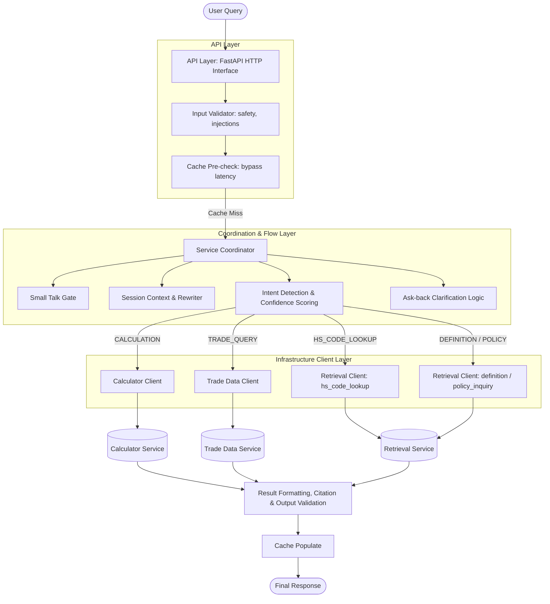

# GDCE Chatbot Orchestrator Architecture

The **Orchestrator Service (v2)** is a FastAPI-based central routing gateway for the GDCE Chatbot system. It manages user input validation, intent classification, multi-turn session memory, context-aware query rewriting, downstream service invocation, response aggregation, and cache population.

---

## 🏗️ Architectural Layers

The service is structured into three distinct layers to segregate HTTP handling, business logic, and backend infrastructure:



### 1. API Layer (`api/endpoints.py`)
This layer handles external interfaces, request validation, and caching.
* **Endpoints:** Exposes the main `/query` and `/chat` (alias) routes, plus diagnostics (`/health`, `/status`, `/info`, and `/query/explain`).
* **First-line Security:** Performs initial input validation (using `input_validator` for injection attacks and scope checking) before any downstream processing happens.
* **Pre-Coordinator Cache:** Checks the cache service. If there's a cached response for the normalized query and it matches a cacheable intent (`calculation`, `hs_code_lookup`, `definition`, etc.), it bypasses downstream calls entirely.

### 2. Coordination & Flow Layer ([coordinator.py](file:///e:/GDCE-Intern/Repo/services_version2/orchestrator/core/coordinator.py), [workflow.py](file:///e:/GDCE-Intern/Repo/services_version2/orchestrator/core/workflow.py))
This layer executes the main orchestrator workflow and maintains dialogue state.
* **Chitchat Detection:** Runs a fast chitchat classifier (`detect_small_talk`). If the user says "Hello" or asks a joke, it responds immediately without invoking downstream databases. *Note: Bypasses the LLM check on turn 2+ to prevent follow-up fragments from being misclassified.*
* **Session Management & Conversational History:** Resolves pronouns or incomplete requests by merging user inputs with the current session context (`RewriterService`). Tracks turn-to-turn context via session parameters (`last_intent`, `last_entity`, `last_raw_query`, `last_normalized_query`).
* **Intent Classifier & Confidence Engine:** Analyzes query semantics (`WorkflowExecutor`) via LLM intent services, falling back to a deterministic keyword-based rule ladder if the LLM fails.
* **Ask-Back Clarification:** If the intent confidence is too low or a calculation/classification query is ambiguous, the orchestrator yields a `clarification_required` response, prompting the user for details instead of routing a bad request. *Bypassed if the turn 2+ query is deemed self-sufficient (e.g. high intent confidence or explicit keywords).*
* **Input Rewriting:** Rewrites the query to optimize it for retrieval services (skipping Trade queries, direct HS lookup, and Calculation queries, which bypass rewriting).

### 3. Infrastructure Client Layer (`infrastructure/clients.py`)
This layer handles communication with remote microservices and encapsulates data adapter lookups.
* **Service Clients:** Houses adapters for:
  - `RetrievalServiceClient` (semantic lookup, definitions, FAQs, and HS Code extraction).
  - `CalculatorServiceClient` (calculating customs duties, taxes, and handling currency extraction/conversions).
  - `TradeDataServiceClient` (fetching trade volumes and trends).
* **Resilience Mechanisms:** 
  - **Circuit Breaker:** Every client implements a circuit breaker (`CLOSED`, `OPEN`, `HALF_OPEN`) to fail-fast if a downstream service goes offline, preventing thread exhaustion.
  - **Retries with Jitter:** Connect errors, timeouts, and transient status codes (5xx, 429) automatically trigger exponential backoff retries with jitter to prevent a thundering herd.
  - **Telemetry Propagation:** Downstream calls are injected with a correlation ID (`X-Request-ID`) to ensure unified tracing.

---

## 🔄 Query Processing Lifecycle

When a request reaches the orchestrator, it runs through the following sequence:

```
[Request] ──> Input Validation ──> Cache Check ──> Session Recovery & Clarification Merge
                  │                                            │
                  └──> Intent Classification & Safety Gates ───┘
                            │
                            ▼
                  [Service Routing]
                  ├── CALCULATION    ──> Calculator Client (Forward Query / Currency Extract)
                  ├── TRADE_QUERY    ──> Trade Client (Extract Trade Params)
                  ├── HS_CODE_LOOKUP ──> Retrieval Client (Generate Answer + Code Validation)
                  └── DEFINITION     ──> Retrieval Client (Definition / FAQ Search)
                            │
                            ▼
                  Response Polishing & Formatting ──> Cache Save ──> [Response]
```

### Step 1: Input Validation & Scope Gate
The API layer passes the query to `input_validator.validate_input_async(question)`:
- **Security Check:** Scans for SQL injection, command injections, or malicious prompt injection patterns. If validation fails, it issues a refusal response.
- **In-Scope Check:** Assures that the query contains customs-related keywords (such as `import`, `export`, `tariff`, `duty`, etc.). If the query is out-of-scope (e.g. general programming question), it is refused.

### Step 2: Cache Lookup (Pre-Coordinator)
The API layer executes a cache lookup using the raw question text:
- If a cached response exists and the intent is cacheable (`calculation`, `hs_code_lookup`, `definition`, `general`, `policy`, `trade_query`), it directly returns the cached output. If the input rewriter is enabled and a session ID is present, the session state is updated (`update_session_for_query`) to preserve turn-to-turn context on subsequent turns.
- If it misses, it forwards the query to `ServiceCoordinator.process_query()`.

### Step 3: HS Code Standardization
The coordinator standardizes any embedded HS codes in the text using regex rules (e.g. converting different delimiter patterns to standard `XXXX.XX.XX` format).

### Step 4: Small Talk Gate
Before launching heavy LLM processing, the query is passed to `detect_small_talk()`. If the input is standard greeting or chitchat, the orchestrator bypasses retrieval/calculation entirely and returns a static or fast generative greeting. On Turn 2+, the LLM chitchat check is bypassed (passing `llm_service=None`) so follow-up fragments can go through rewrite/ask-back logic instead of being misclassified.

### Step 5: Dialogue Context & Clarification Merging
If the request includes a `session_id`:
- It loads the session context history early in the processing flow.
- If the session history indicates the bot was waiting for clarification (e.g., the user answered a question about an engine's CC or preferred duty rate), it merges the new user reply with the pending query (`_merge_pending_with_clarification`).
- **Clarification Merging Logic:** Uses the shared entity resolution utility (`extract_entity`). Priority: (1) entity in the turn-2 fragment, (2) turn-1 entity fallback (`last_entity`), (3) fallback to pending query. If the resolved intent is `CALCULATION` and the previous turn was also calculation, it retrieves context parameters (CIF, currency, origin country) using `CalculatorServiceClient._parse_question_for_calculation` and reformulates a fully defined calculation query. It also performs pronoun replacement ("its" etc.) and prepends the resolved entity if missing from the response.

### Step 6: Two-Layer Intent Detection
`WorkflowExecutor` determines the query's intent:
1. **LLM Intent Classifier (Primary):** Semantically evaluates the query, generating an intent label and a confidence score.
2. **Keyword Fallback (Secondary):** If the LLM confidence is low, the system falls back to a deterministic rule ladder matching key phrases (e.g. "calculate tax", "how to import") to assign the intent.

### Step 7: Clarification Ask-Back Check
If the intent confidence is low or ambiguous:
- The orchestrator suspends the workflow.
- It triggers a `clarification_required` response to the user with a selection list or question (e.g. "I still wasn't sure which option you meant...").
- **Self-Sufficiency Check:** On Turn 2+, if the query states its own intent clearly enough (either confidence >= 0.75 or has explicit intent-signalling keywords), it is deemed self-sufficient and the ask-back clarification check is skipped, routing the query directly.

### Step 8: Safety Gates & Intent Overrides
The coordinator applies structural overrides:
- If the user is pursuing a calculation dialogue and mentions a product, it preserves the `CALCULATION` intent.
- If the query consists of a short product category name (e.g. "tomatoes"), it overrides the intent to `HS_CODE_LOOKUP`.
- Service-based questions (e.g. scanning fees) are forced to `POLICY_QUERY` to bypass product lookup.

### Step 9: Context-Aware Query Rewriting
If rewriting is enabled and the intent is not `TRADE_QUERY`, `HS_CODE_LOOKUP`, or `CALCULATION` (which bypass rewriting so their downstream services receive the raw/canonical query for structured parsing), the coordinator asks the LLM to rewrite the query into an optimized form containing historical session context.

### Step 10: Downstream Client Routing
The coordinator dispatches the cleaned query (`_route_query`) to the target client:
* **`CALCULATION`**: Invokes the `CalculatorServiceClient` using the query, while the client automatically extracts explicit currencies and fetches exchange rates from PostgreSQL.
* **`TRADE_QUERY`**: Extracts parameters (export, import, year, countries) and queries the `TradeDataServiceClient`.
* **`HS_CODE_LOOKUP`**: Queries the `RetrievalServiceClient.hs_code_lookup()` endpoint, retrieving candidate codes.
* **`DEFINITION` / `POLICY_QUERY` / Default**: Queries semantic retrieval indexes.

### Step 11: Response Formatting & Caching
1. **Aggregating Results:** Downstream outputs, errors, and warnings are collected.
2. **Polishing Response:** Unless it is a trade or calculation query (which are formatted using specific tables or markdown structures), the raw retrieval texts are passed to the `OrchestratorFormatterService` to compose a polished reply.
3. **Caching:** The final formatted answer is saved back to the cache with an intent-specific TTL.
4. **Return:** The finished `QueryResponse` containing the answer text, citation snippets, and metadata is returned to the user.
