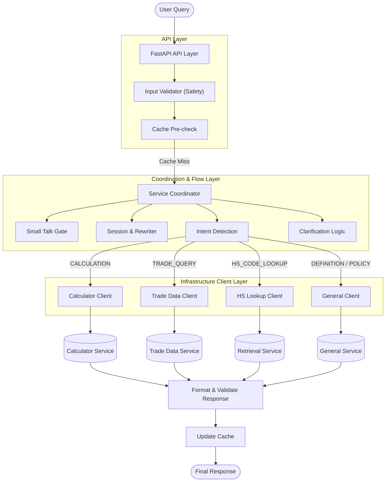

# Technical Slide Update Outline: GDCE Chatbot Orchestrator Service (v2)

This document provides a slide-by-slide outline along with a complete presenter script for your upcoming technical update with your supervisor. It is designed to demonstrate deep architectural design, clear performance optimization metrics (addressing the latency challenge), code-level data flow, and containerization standards.

---

## 📊 Slide 1: Title & Overview
*   **Slide Title:** GDCE Chatbot Orchestrator Service (v2)
*   **Subtitle:** Centralized Routing, Latency Optimization, and Multi-Turn Session Management
*   **Key Points to Cover:**
    *   What is the Orchestrator? It is a FastAPI-based central routing gateway for the GDCE Chatbot system.
    *   What problem does it solve? Standardizes routing, handles dialogue flow state, ensures fail-safe downstream service calls, and enforces security/safety boundaries.
    *   Core technology stack: FastAPI, Python 3.11, Gemini models (LLM), Rule-based/Keyword fallbacks for intent (eliminating local MiniLM embedding model dependency), Qdrant/OpenSearch (Vector retrieval downstream), Redis (Caching layer).
    *   Pruned Container Footprint: Pruned local deep learning dependencies (`torch` and `sentence-transformers`), reducing container size and speed of startup.

> 🎙️ **Presenter Talking Script:**
> *"Hi everyone. Today, I want to update you on our Chatbot Orchestrator, which is now on version 2. You can think of the Orchestrator as the front door or central dispatcher of our chatbot system. When a user asks a question, this service handles it first. It makes sure the query is safe, figures out what the user wants, remembers context from past turns, and routes the question to the right place. Under the hood, we run on Python and FastAPI, using Gemini as our main AI engine, rule-based keywords for quick fallbacks to keep the container extremely slim and fast, and Redis to cache common answers so we can respond instantly."*

---

## 🏗️ Slide 2: Three-Layer Service Architecture
*   **Slide Title:** Architectural Separation of Concerns
*   **Key Points to Cover:**
    *   **API Layer (`api/endpoints.py`):** Establishes the HTTP interface (`/query`, `/chat`), validates input payloads, checks Redis pre-coordinator cache, and serves Kubernetes/Docker liveness/readiness probes.
    *   **Coordination & Flow Layer (`core/coordinator.py`, `core/workflow.py`):** Governs dialogue states, intent classification (Gemini + rule-based keywords fallback), query rewriting, and ask-back clarification flow.
    *   **Infrastructure Client Layer (`infrastructure/clients.py`):** Communicates with downstream microservices (`Retrieval`, `Calculator`, `TradeData`, `General`). Inherently resilient via **Circuit Breaker** (fails fast if downstream is down to prevent thread exhaustion), **exponential retry backoff with jitter**, and **correlation ID (`X-Request-ID`) propagation** for tracing.
    *   **Dedicated General Client Routing:** Introduced `GeneralServiceClient` to decouple general Q&A (definition, policy queries) from the main `RetrievalServiceClient`, sending requests to port `8005`.

### 🖼️ Architecture Diagram (Mermaid)


> 🎙️ **Presenter Talking Script:**
> *"To keep our code clean, we split the service into three simple parts. First, the API Layer handles incoming web requests, checks safety rules, and looks at our cache first to save time. Second, the Coordination Layer is the brain. It manages the conversation flow, decides what type of question the user is asking, and rewrites the query if needed. Third, the Infrastructure Client Layer talks to our downstream services like the calculator, retrieval, or our general Ask service. We've added safety nets here: if a downstream service goes down, the orchestrator stops trying immediately so it doesn't freeze the system, and it retries automatically if it's just a temporary glitch."*

---

## ⚡ Slide 3: The Latency Challenge & Unified First-Layer Pipeline
*   **Slide Title:** Optimizing Front-Door NLP: From Cumulative to Unified Processing
*   **Key Points to Cover:**
    *   **The Latency Challenge:** In legacy systems, processing a query required multiple independent, sequential LLM round-trips (Input Validation $\rightarrow$ Intent Classification $\rightarrow$ Query Rewriting). Round-trip network latency was cumulative, taking **2–3 seconds** at the front door before routing even occurred.
    *   **The Solution: Unified `llm_first_layer`:** Consolidates NLP tasks into a single coordinated pipeline (`FirstLayerPipeline`) that runs in sequence and shares session/context.
    *   **Pipeline Stages:**
        1.  **Input Validation:** Async fast-pass security evaluation.
        2.  **Intent Detection:** Semantic classification (Gemini) with confidence scoring.
        3.  **Ambiguity Check:** Halts the pipeline immediately if confidence is low, triggering an early exit for clarification (Ask-Back).
        4.  **Contextual Remembering:** Resolves pronoun references and caches conversation parameters (e.g., product entities, previous values) from earlier turns to ensure session continuity.
        5.  **Query Rewriting:** Conditional Gemini rewrite to incorporate history (skipped for Trade, HS Code Lookup, and Calculation queries to preserve precise technical search terms).
    *   **Robust Service Timeouts:** Increased timeout configurations across all intents (e.g., HS Lookup to 60s, General to 50s, Trade to 40s) and downstream clients to safely handle complex multi-step reasoning without premature service termination.

> 🎙️ **Presenter Talking Script:**
> *"In the past, we had a major speed issue. Every time a user sent a message, the chatbot had to make three separate AI calls one after another: first to validate, then to check intent, and then to rewrite the query. This meant the user had to wait 2 to 3 seconds just for the front-door checks. To fix this, we merged these steps into one single pipeline. Now, we do everything in one flow. We validate, identify the intent, check if the question is too vague, remember past context, and rewrite the query. Doing this in one pipeline instead of three separate steps makes the bot much faster. We also scaled up our service and intent timeouts—like increasing HS Lookup to 60 seconds—so that complex, multi-step AI operations have enough room to complete successfully."*

---

## 🌁 Slide 4: Design Patterns: The Compatibility Bridge (Shims)
*   **Slide Title:** Refactoring Without Breaking: The Shim Pattern
*   **Key Points to Cover:**
    *   **The Challenge:** A full refactor of imports in `coordinator.py`, submodules, and integration tests (`tests/test_validator_service.py`) introduces high regression risk and breaks APIs.
    *   **The Pattern & Consolidation:** Implemented lightweight structural bridges (Shims) in `llm_first_layer/shims/` and completely deleted redundant files like `core/validators.py`:
        *   `intent_service.py`: Keeps legacy configurations passing through, returning the unified singleton instance instead of a separate client.
        *   `rewriter_service.py`: Routes `self.rewriter_service.rewrite_input` to the consolidated service singleton.
        *   `validator_service.py`: Houses the consolidated input validator (`validate_input_full`) which integrates local security, injection prevention, domain blocklists, and whitelists with async Gemini fallbacks.
    *   **Benefits:** **Zero breaking changes** to legacy files; centralized lifecycle control (prevents connection leaks or API key conflicts); and DRY (Don't Repeat Yourself) prompts.

> 🎙️ **Presenter Talking Script:**
> *"When we consolidated those three steps into one pipeline, we didn't want to break all the existing code that was already using the old, separate services. So, we used a design pattern called a 'Shim'. You can think of a shim as an adapter or a bridge. It looks exactly like the old services to the rest of our codebase, but under the hood, it just forwards all calls to our new unified pipeline. In fact, we completely removed our old validators file and moved all of that logic right into the shim. This let us optimize the speed and clean up our code without having to rewrite or break our existing tests."*

---

## 🔄 Slide 5: Multi-Turn Conversation & Ask-Back Clarification Logic
*   **Slide Title:** Resolving Dialogue Ambiguity (Ask-Back Flow)
*   **Key Points to Cover:**
    *   If the primary intent classification confidence is too low ($< 0.75$), or if the user supplies an ambiguous follow-up fragment on Turn 2+, the system triggers `clarification_required`.
    *   Instead of guessing or failing, the system halts the coordinator workflow, saves the pending query, and prompts the user with specific intent candidate options.
    *   Once the user replies, the system maps the response to an intent, retrieves the pending context, and executes query merging.

### 🔄 Ambiguity & Merging Lifecycle
```
[User Turn 2 Fragment] ──> First-Layer Pipeline 
                                   │
                     (Confidence < 0.75 or Follow-up prefix?)
                                   │
                                   ▼ [Yes]
                     Suspend workflow & cache context
                     Return "clarification_required" + Candidates
                                   │
                                   ▼ [User responds in Turn 3]
                     Resolve response to matching Candidate
                     Execute _merge_pending_with_clarification()
                                   │
                                   ▼
                     Validate Merged Query ──[Valid]──> Route to Client
```

> 🎙️ **Presenter Talking Script:**
> *"Sometimes, a user's question is too short or unclear, and the AI isn't confident about what they want. Instead of guessing and giving a wrong answer, the system triggers a clarification check, which we call 'Ask-Back'. The orchestrator pauses the query, remembers what the user was talking about, and asks them to choose from a list of options. Once the user clicks or types their choice, the system connects it back to the original question and finishes the task."*

---

## 🔬 Slide 6: Deep Dive: Clarification Merging & Context Preservation
*   **Slide Title:** Context-Aware Query Merging (`_merge_pending_with_clarification`)
*   **Key Points to Cover:**
    *   The `_merge_pending_with_clarification` method combines the original user fragment, the new user input, and the session context into a single clean canonical query.
    *   **Entity Resolution Priority:**
        1.  Extract entity from Turn-2 fragment (e.g., `what about boat?` $\rightarrow$ entity = `boat`).
        2.  Fall back to Turn-1 entity held in session context (`session_last_entity`).
        3.  Default back to pending query.
    *   **Pronoun Replacement:** Checks for pronouns (`its`, `it`, etc.) in the user response and swaps them with the resolved entity (e.g., `"its HS code"` + entity `"boat"` $\rightarrow$ `"boat HS code"`).
    *   **Calculation Context Preservation:** Special rule for `CALCULATION` intent. If the previous turn was a calculation, it extracts CIF value, currency, and country, then rebuilds the formula:
        *   *Formula:* `Calculate import tax for [New Entity] [Currency][CIF Value] from [Country]`

> 🎙️ **Presenter Talking Script:**
> *"How do we actually merge the original question with the user's clarification? We have a method that handles this. First, it looks for the main product or topic the user is talking about. It checks the latest message first, and if nothing is there, it falls back to what they mentioned in the previous turn. Second, if the user uses pronouns like 'it' or 'its', the code replaces them with the actual product name. Finally, if they are calculating taxes, the system remembers the price, currency, and country from the previous turn so the user doesn't have to type all that information again."*

---

## 💡 Slide 7: Walkthrough: A Real Multi-Turn Scenario
*   **Slide Title:** Multi-Turn Scenario in Action
*   **Scenario Walkthrough:**

| Turn / Actor | Input Query / Action | Internal System State / Logic | Output / Action |
| :--- | :--- | :--- | :--- |
| **Turn 1: User** | `"What is the HS code of a car?"` | Intent: `hs_code_lookup`. Entity extracted: `car`. | Returns search results for cars. Saves `last_entity="car"` in session. |
| **Turn 2: User** | `"What about boat?"` | Matches follow-up fragment rules. Confident intent score is low. | Triggers **Ask-Back**. Prompts user: `"Would that be related to trade data, hs code lookup, general question, or calculation?"` |
| **Turn 3: User** | `"hs code"` | Matches candidate `"hs_code_lookup"`. | Resolves intent to `hs_code_lookup`. Runs `_merge_pending_with_clarification`. |
| **System Logic** | *Merging Execution* | Entity resolved: `boat` (Turn-2 entity). Clarification: `"hs code"`. Entity is prepended because it is missing in the clarification response. | Merged query: `"boat hs code"`. |
| **Turn 3: System** | *Downstream Execution* | Forwarded query `"boat hs code"` to `RetrievalServiceClient`. | Returns search results for boats. |

> 🎙️ **Presenter Talking Script:**
> *"Let's look at a quick example. First, the user asks: 'What is the HS code of a car?' The bot answers, and remembers that we are talking about a 'car'. Next, the user asks: 'What about boat?' This is too short and ambiguous, so the bot asks: 'Is this related to trade data, HS codes, or calculation?' The user replies: 'hs code'. The system takes the word 'boat' from the previous turn, combines it with 'hs code', and runs a search for 'boat hs code'. This makes the conversation feel natural."*

---

## 🐳 Slide 8: Docker Standardization & Network Orchestration
*   **Slide Title:** Docker Containerization & Shared Network Routing
*   **Key Points to Cover:**
    *   **Base Image Selection:** Uses `python:3.11-slim` to reduce container footprint, security vulnerabilities, and deployment cold starts.
    *   **Pruned Dependencies (No PyTorch/SentenceTransformers):** Completely removed local MiniLM embeddings, `torch`, and `sentence-transformers` dependencies. This eliminates the large PyTorch build step, minimizes the image size by hundreds of megabytes, and slashes build and startup time.
    *   **Module Namespace Execution:** Executes the app via `python -m services_version2.orchestrator.main` rather than running a loose script. This preserves relative package imports in python.
    *   **Containerized Networking via Shared Network:** Removed direct localhost gateway (`host.docker.internal` / `extra_hosts`) routing. The service now runs on a shared external Docker network (`gdce-network`) and communicates with other microservices (`retrieval-service`, `calculator`, `trade-service`, `general-service`) directly using their Docker service names.

> 🎙️ **Presenter Talking Script:**
> *"For deployment, we standardized our setup using Docker. We use a lightweight version of Python to keep the container size small. By completely eliminating local embedding models, we got rid of PyTorch and sentence-transformers. This shaved hundreds of megabytes off our image size and drastically reduced container startup and build times. We also modernized our networking: instead of routing traffic back to the host machine using special host gateways, the orchestrator now communicates directly with other services like retrieval and calculator using standard container names inside a shared external Docker network."*

---

## ⚙️ Slide 9: API & Environment Parameterization
*   **Slide Title:** Environment Parameterization & Diagnostic Probes
*   **Key Points to Cover:**
    *   **Port & Endpoints:** The service runs on port `8001`. Exposes primary client interaction routes at `/query` (for downstream service orchestration) and `/chat` (as an alias route).
    *   **Externalized Configurations:** Environment variables injected inside `docker-compose.yml` point directly to microservices inside the shared external `gdce-network` (e.g., `http://retrieval-service:8003`, `http://general-service:8005`, `http://trade-service:8004`, `http://calculator:8002`).
    *   **Stateless Architecture:** Completely removed legacy PostgreSQL database adapter (`postgres_adapter.py`), decoupling the orchestrator from raw database sessions and delegating data lookup entirely to downstream services.
    *   **Diagnostic Endpoints:**
        *   `/health`: Liveness probe for Docker/K8s to check process health.
        *   `/status`: Readiness probe to verify model availability and downstream network client connections before routing user traffic.
        *   `/query/explain`: Developer diagnostic endpoint to return intent confidence scores, classification steps, and rewrite latency breakdown.
    *   **Telemetry Integration:** Correlation IDs (`X-Request-ID`) mapped and injected to all downstream HTTP clients so logs can be aggregated and traced end-to-end.

> 🎙️ **Presenter Talking Script:**
> *"Finally, the chatbot service runs on port 8001, and users interact with it through our main `/query` and `/chat` endpoints. We make it easy to deploy the chatbot anywhere by using environment configuration files to point to our services on the shared Docker network. We also fully decoupled the orchestrator from direct database connections, deleting the legacy PostgreSQL adapter to keep the service purely stateless. We have health-check URLs so that our server monitors know if the chatbot is running fine. We also created a special diagnostics page for developers to see why the AI made a certain decision and how long each step took. This helps us debug issues quickly. That's a high-level summary of our work. Thank you, and let me know if you have any questions!"*
